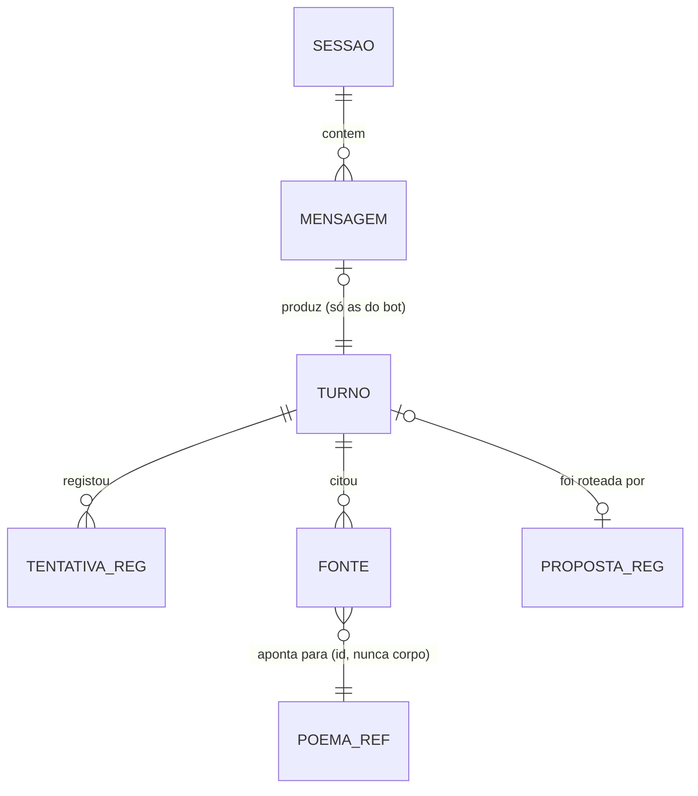

# Fase 6 — A interface gráfica: dar corpo ao que o CLI já sabe fazer

**A fase que o [`CONTROLO.md`](CONTROLO.md) §2 lista como «⬜ não planeada em
detalhe».** Escrita em 2026-10-12. **É uma fase de produto:** o entregável é
código em `src/web/` e um ficheiro estático, não um relatório — mas tem portões,
e os portões são de **paridade**, não de gosto.

O plano original ([`PLANO-RAG-LOCAL.md`](PLANO-RAG-LOCAL.md) §5, «Fase 5 —
Interface e backend remoto») diz uma linha e meia: «FastAPI + Gradio, histórico
de conversa, e o `AnthropicRemote` como opção». Este documento substitui essa
linha. Das três coisas que ela nomeia, **uma entra, uma entra mudada e uma sai** —
e as três têm motivo abaixo.

---

## 0. A regra que governa esta fase toda

> **A interface não decide nada.** Recuperação, montagem de prompt, guarda,
> detector de plágio e política de repetição são os mesmos objectos que o CLI
> corre. A interface é um **terceiro consumidor** do `Pipeline`, ao lado do laço
> escrito à mão (`src/cli.py`) e do grafo de estado (`src/grafo.py`).

Isto não é higiene arquitectónica: é o que mantém válidos os números medidos nas
Fases 0 a 5Y. Uma interface que reimplementasse a limpeza do início do fluxo, ou
que mandasse `top_k` diferente, produzia respostas que **nenhuma medição deste
repositório descreve** — e a Fase 5Y já mostrou o que custa descobrir tarde que
dois caminhos divergiam em silêncio (de 7% a 40% das células contaminadas, fase
a fase).

O precedente está escrito e é o modelo a seguir: `tests/test_grafo.py` compara o
laço e o grafo **resposta a resposta** — texto, número de tentativas, veredicto e
poemas usados — e falha se divergirem. O portão **I1** desta fase é o mesmo
teste, com um terceiro braço.

---

## 1. Pilha técnica

### 1.1 A decisão, e as três alternativas que perdem

| opção | o que custa | porque não |
|---|---|---|
| **Gradio** (o que o plano dizia) | `gradio` arrasta `fastapi` + `uvicorn` + `pydantic` + o seu próprio JS compilado | esconde a fronteira HTTP, e é **a fronteira que eu preciso de testar**. O `ChatInterface` não tem onde pôr o rodapé de fontes e tempos sem o reescrever, nem onde pôr uma tentativa **rejeitada e mantida à vista** (§4.4). E a API dele muda entre versões menores |
| **FastAPI + React/Svelte** | Node, `node_modules`, um passo de build | uma página de conversa não paga um segundo ecossistema de empacotamento num repositório que é Python e tem **zero** linhas de JS |
| **TUI (Textual)** | 1 dependência | não é uma interface **gráfica**, que é o que esta fase pede. E o CLI já é a interface de terminal |
| ✅ **FastAPI + Uvicorn + uma página estática em JS sem build** | 2 dependências declaradas | controlo total do que §4 exige, **sem passo de compilação**: um `index.html`, um `app.js`, um `estilo.css`, servidos como ficheiros. A fronteira HTTP fica explícita, e portanto testável com o `TestClient` |

### 1.2 A pilha

| camada | escolha | motivo |
|---|---|---|
| servidor | **FastAPI** + **Uvicorn** | resposta em fluxo (`StreamingResponse`), `TestClient` para os portões, e tipos nas fronteiras |
| transporte do fluxo | **POST com corpo de resposta em NDJSON** | ver §1.3 — não é SSE, e a razão é de privacidade e não de gosto |
| cliente | **HTML + CSS + JS sem framework nem build** | ~400 linhas. Lê o fluxo com `response.body.getReader()`, que é API nativa desde 2017 |
| persistência | **`sqlite3` da biblioteca-padrão** | zero dependências novas; `data/sessoes.db`, fora do repositório (§3.4) |
| serialização | **funções explícitas em `src/web/serial.py`** | ver §1.4 — os modelos de domínio **não** são re-declarados em `pydantic` |
| processo | **um só**, longo | o encoder, o índice e (se pedido) o reranker de 568M carregam **uma vez**. Um modelo por pedido era absurdo: o índice sozinho custa 6,4 min a construir |

Entram no `requirements.txt` **duas** linhas — `fastapi` e `uvicorn` — com o
comentário que esta casa exige: dependência declarada e não exercida é dívida
(a lição de 01/10, no topo do ficheiro), logo entram no mesmo commit que o
código que as importa e que os testes que falham sem elas.

### 1.3 Porque NÃO é SSE

O `EventSource` do navegador só faz **GET**. Com GET, a pergunta do utilizador
viaja na *query string* — e a pergunta é texto que a pessoa escreveu. Texto de
utilizador em URL fica no histórico do navegador e nos registos de qualquer coisa
que esteja no caminho. O POST com corpo em fluxo evita isso, resolve-se numa
chamada só (sem par «POST devolve id / GET subscreve id»), e cancela-se com
`AbortController`.

O custo: perde-se a reconexão automática do `EventSource`. Não faz falta —
o servidor está em `127.0.0.1` e a geração não é retomável de qualquer forma.

### 1.4 Porque não há modelos `pydantic` do domínio

`Turno`, `Tentativa`, `Resposta`, `Veredicto`, `Analise`, `Chunk` e `Poem` são
`@dataclass(frozen=True)` e são a fronteira do sistema. Declará-los outra vez em
`pydantic` criava **duas definições da mesma coisa**, e a segunda derivaria da
primeira em silêncio no dia em que um campo mudasse — exactamente o modo de
falha que o manifesto do índice existe para impedir (`src/retrieval/index.py`: um
índice velho «não dá erro: dá respostas erradas»).

Em vez disso: **um ficheiro**, `src/web/serial.py`, com uma função por tipo. O
formato do fio fica numa página que se lê de uma vez, e um campo novo no domínio
que ninguém serializou é visível à vista desarmada.

---

## 2. Arquitectura

```
navegador  ──── POST /api/perguntar ────┐
   │  (NDJSON em fluxo, uma linha por evento)
   │                                    │
   │  GET /api/estado    prontidão por componente
   │  GET /api/vozes     vozes × línguas disponíveis
   │  GET /api/poema/{id}  corpo do poema (só 127.0.0.1, §3.3)
   │  GET /api/sessoes   histórico, para reabrir
   │                                    │
   └────────────────────────────────────┘
                                        │
                              ┌─────────▼──────────┐
                              │  src/web/app.py    │  FastAPI
                              │  src/web/estado.py │  ciclo de vida, trinco
                              │  src/web/serial.py │  domínio → JSON
                              └─────────┬──────────┘
                                        │ asyncio.to_thread
                              ┌─────────▼──────────┐
                              │   src/pipeline.py  │  SEM ALTERAÇÃO
                              │   responder_em_fluxo
                              └─────────┬──────────┘
                     recuperar · montar · gerar · verificar · repetir
```

### 2.1 O pipeline é síncrono e o servidor é assíncrono

`responder_em_fluxo` é um gerador bloqueante: faz produto matriz-vector em
`numpy` e lê um `requests.post(stream=True)`. Posto directamente num `async def`,
**bloqueia o laço de eventos** — e com ele o `GET /api/estado`, que é precisamente
o que a interface usa para mostrar que está viva durante os 19 s de prefill.

Decisão: o gerador corre numa *thread* de trabalho e os fragmentos passam para o
laço por uma fila. O padrão é fechado e cabe em ~30 linhas em `src/web/fluxo.py`.
O portão **I4** verifica-o: durante uma geração, `GET /api/estado` responde em
menos de 100 ms.

### 2.2 Uma geração de cada vez

Há **um** Ollama, **um** encoder e **um** reranker, numa máquina que a Fase 0
mediu a fazer *throttling* térmico até 101 °C. Duas gerações em paralelo não
dariam duas respostas em 30 s: dariam duas em 70 s, com os tempos do rodapé a
mentir, porque `prefill_s` e `decode_s` vêm do Ollama e não sabem que estavam a
competir.

Decisão: **trinco (`asyncio.Lock`) em volta da geração**, e o segundo pedido
recebe `409` com o tempo estimado de espera. A interface desactiva o botão e
di-lo. Não é uma limitação a esconder — é a verdade do hardware, e esconder o
custo é o que este repositório não faz.

### 2.3 Cancelamento

O CLI trata `KeyboardInterrupt` e imprime «(interrompido)». O equivalente no
navegador é `AbortController`. Mas **abortar o `fetch` não para o Ollama**: ele
continua a decodificar até ao `num_predict` (220), a gastar CPU que a pergunta
seguinte vai querer.

Tarefa explícita, com verificação: ao fechar o lado do cliente, fechar a resposta
do `requests` e confirmar — por `GET /api/ps` do Ollama ou pelo tempo da pergunta
seguinte — que a geração **parou**. Se não parar, o trinco do §2.2 fica retido e
a interface mente. Portão **I5**.

### 2.4 O trinco do §2.2 não chega: há outro processo a usar o mesmo Ollama

O trinco do §2.2 é um `asyncio.Lock`, isto é, **por processo**. E há um segundo
processo, que não é hipotético: `docs/fase-5z/gerar_amostras.py` — como os
geradores de todas as fases antes dele — importa
`src.generation.ollama.OllamaGenerator`, logo fala com o **mesmo**
`URL_BASE = 127.0.0.1:11434` e o **mesmo** `MODELO`. O trinco dá **zero**
protecção contra ele.

Correr o servidor com uma fase a gerar tem três consequências, por ordem de
custo:

| | o que acontece | custo |
|---|---|---|
| 1 | o rodapé mente: `prefill_s` e `decode_s` vêm do Ollama e não sabem que competiram | cosmético |
| 2 | o campo `segundos` do `01-cru.jsonl` da fase fica ininterpretável | **caro, e com precedente nesta casa**: o cache de KV reaproveitado entre repetições de um *benchmark* reportou prefill a 25 625 tok/s e invalidou 4 horas de dados (`CONTROLO.md` §4, «defeitos encontrados nos meus próprios instrumentos») |
| 3 | `_opcoes` **nunca define `num_ctx`**, logo vale o valor por omissão do Ollama. Com `OLLAMA_NUM_PARALLEL > 1` o contexto é dividido pelos *slots*, e um prompt de ~1800–2000 tokens pode ser **truncado em silêncio** num dos braços | **potencialmente invalidante**: a 5Z fixa sementes (`SEMENTE_BASE + 100*r + i`) para comparação emparelhada, logo isto muda o **texto** e não só o tempo — e de forma **assimétrica entre braços**, que é exactamente o que a auditoria da 5Y existe para apanhar |

⚠️ **O (3) é hipótese, não medição.** Verifica-se com `OLLAMA_NUM_PARALLEL=1`
explícito e um `GET /api/ps` durante uma geração, a confirmar um *slot* só. Hoje
não há variável `OLLAMA_*` nenhuma no ambiente, logo está no valor por omissão —
que não é 1 nas versões recentes.

#### A segunda colisão, que não é do Ollama

O servidor tem o índice **em memória**, e a verificação do manifesto corre **só
no carregamento**. Uma fase que reconstrua `data/index.npy` com o servidor
ligado deixa-o a servir um índice velho **sem erro nenhum** — que é, à letra, o
modo de falha que o `src/retrieval/index.py` existe para impedir: «um índice
velho carregado por engano não dá erro: dá respostas erradas».

#### A decisão: sentinela em ficheiro, e de sentido único

O interbloqueio tem de ser **entre processos**, e **o servidor é que cede à
medição** — nunca o contrário. Uma medição interrompida a meio perde-se; uma
pergunta recusada repete-se com uma tecla.

Não se retroajusta um trinco aos `gerar_amostras.py` das fases fechadas: são
artefactos commitados, e o `pyproject.toml` já diz porque é que nem o formatador
lhes toca — «reformatá-los reescrevia o registo». Logo o mecanismo é o mais
estúpido que funciona:

- um ficheiro-sentinela com o nome da fase e o PID lá dentro, para que um
  sentinela esquecido se diagnostique. **Este documento escreveu
  `data/.medicao-a-correr` e isso estava errado** — não por gosto, por modo de
  falha: o [plano do serviço público](PRODUCAO.md) §4 mostrou, antes do passo 7
  ser escrito, que o serviço corre num **segundo checkout** e portanto há **dois
  `data/`** — a fase escreve no seu, o servidor verifica o outro, e o mecanismo
  fica **silenciosamente desligado**. Passou a
  `~/.local/state/pessoabot/.medicao-a-correr` — **absoluto, único na máquina,
  fora de qualquer checkout** —, com `PESSOABOT_SENTINELA` a sobrepô-lo para os
  testes. **Uma** variável e não duas: o `XDG_STATE_HOME` ficou de fora porque os
  dois processos têm de concordar no caminho, e cada fonte de verdade a mais é
  outra maneira de discordarem;
- o servidor verifica-o **antes de cada geração**, não no arranque, e recusa com
  `409` e a mensagem que diz o que está a correr e como se liberta;
- o `GET /api/estado` reporta-o como um componente, ao lado do `ollama` e do
  `índice` (§4.2), porque é informação de prontidão como as outras;
- quem cria e apaga o ficheiro é quem corre a fase. Para as fases **futuras**,
  um ajudante de três linhas em `src/web/sentinela.py` (contexto `with`) — e as
  fechadas ficam como estão.

**Zero alterações ao caminho medido** e zero a scripts fechados: nada disto entra
em `src/generation/ollama.py`. Pô-lo lá era o sítio arquitectonicamente certo e
a decisão errada — acrescentava um `flock` a cada chamada HTTP do caminho que as
Fases 0 a 5Y mediram, e isso é uma mudança que precisava de medição própria.

Portão **I8**.

#### O que o passo 7 entregou, e as três coisas que o plano não tinha previsto

Feito em 2026-10-18, em `src/web/sentinela.py` — **nada** fora de `src/web/`
foi tocado, e a asserção de não-regressão do §6 está cumprida. 24 testes
novos, `pytest` a **377** (eram 353).

**1. O caminho, que já está corrigido acima.** Veio do
[`PRODUCAO.md`](PRODUCAO.md) §4 e entrou antes do código, não depois. Está
registado como correcção **39** no [`CONTROLO.md`](CONTROLO.md) §4 — a primeira
dessa lista a ser apanhada antes de custar algo.

**2. O I8 ganhou a asserção dos dois checkouts, e ela está verificada por
mutação.** Com o `caminho()` revertido ao `data/.medicao-a-correr`
especificado, `test_i8_a_fase_de_um_checkout_e_vista_pelo_servidor_do_outro`
falha — e falha de uma maneira que vale escrever, porque a asserção
**anterior** no mesmo teste passa: `caminho() == caminho()` é verdade dos dois
lados (`data/.medicao-a-correr` é igual a `data/.medicao-a-correr`) e aponta a
**ficheiros diferentes**. O que falha é a linha seguinte, `assert (None is not
None)`: o servidor do segundo checkout não vê nada e **gera**. Era a forma mais
pura do modo de falha que se podia pedir, e um teste num processo com um
directório só nunca a mostrava.

**3. O `/api/estado` passou a ter três casos por componente, e não dois.** O
sentinela entra no **`pode_perguntar`** e **não** no `pronto`, e a decisão é
deliberada: o `pronto` afirma «está tudo verificado?», que é uma afirmação
sobre o **sistema**, e uma medição a correr não avaria nada — é uma
**cedência**. Metê-la no `pronto` fazia a página acender a cruz vermelha de
avaria sobre uma decisão de quem corre a casa. Mas tem de fechar o botão, senão
o utilizador escreve a pergunta e recebe o 409 — que é a surpresa que a
distinção `pronto`/`pode_perguntar` nasceu para evitar (§4.2, e o defeito foi
observado a correr no passo 5).

Consequência que o plano não previa: com dois campos no fio (`pronto`,
`exigido`) a página rotulava o sentinela **«escolha»**, e ninguém escolheu
aquilo na interface. Daí um `bloqueante` por componente e um terceiro estado na
página — `⏸`, na cor do realce e não na do erro. Os três casos são agora
**avaria**, **cedência** e **escolha desligada**, e a página distingue-os porque
o servidor lhos diz.

E duas peças que ficaram **de fora de propósito**, porque são do
[`PRODUCAO.md`](PRODUCAO.md) e não desta fase: o ajudante `with` **não** para o
túnel (passo 5 desse plano — e não há `cloudflared` nem `tailscale` nesta
máquina) e a **janela** não fica registada ao lado das amostras (passo 7). O
`medicao()` marca em comentário as duas linhas onde a primeira entra, e a ordem
— parar depois de escrever, arrancar antes de limpar — está lá escrita, porque
invertê-la abria exactamente a janela que o mecanismo fecha.

O custo no caminho do portão **I4**: medido, **7,9 µs** sem ficheiro e
**15,6 µs** com ele, contra um orçamento de 100 ms para a resposta inteira do
`/api/estado`. O I4 foi corrido cinco vezes depois desta peça entrar e passou
5 de 5.

---

## 3. Entidades e relacionamentos

São **duas camadas**, e a distinção importa: a primeira já existe e **não se
toca**; a segunda nasce nesta fase, porque é o que o CLI nunca teve — memória.

### 3.1 O domínio que já existe (leitura, sem alteração)

| entidade | onde | o que é |
|---|---|---|
| `Voice` | `corpus/models.py` | enum das 7 vozes, com a distribuição medida nos 2083 ficheiros |
| `Lang` | `corpus/models.py` | `PT` · `EN` · `INDETERMINADO` |
| `Poem` | `corpus/models.py` | id, autor normalizado, voz, título, corpo, língua, estrofes, `duplicate_of` |
| `Chunk` | `corpus/models.py` | unidade de indexação; `text` vai ao **prompt**, `indexed_text` vai ao **índice** |
| `Persona` | `voices.py` | `(Voice, Lang) → Persona`; é ela que gera o `system_prompt` |
| `Resposta` | `generation/base.py` | texto + `prefill_s`, `decode_s`, tokens, `truncada` |
| `Veredicto` | `guard.py` | `ok`, `motivos`, `texto` **já limpo**, `suspeitas`, `gramatica` |
| `Analise` / `VersoCopiado` | `plagio.py` | fracção copiada, máximo de similaridade, verso a verso com o poema de origem |
| `Tentativa` | `pipeline.py` | o que uma tentativa **foi**, antes de o sistema a corrigir (existe por causa da 5Y) |
| `Turno` | `pipeline.py` | a resposta a uma pergunta: recuperados, usados, veredicto, plágio, tentativas, tempos, `historico` |
| `Proposta` | `roteador.py` | a voz que o roteador propõe, o texto bruto e os segundos; `voz is None` = «não sei» |
| `Manifesto` | `retrieval/index.py` | encoder, dimensão, assinatura do corpus, contagem **e ordem** dos ids |

### 3.2 As entidades novas



| entidade | campos | porque existe |
|---|---|---|
| **`Sessao`** | `id`, `criada_em`, `voz_inicial`, `idioma_inicial`, `modelo`, `rerank_ligado`, `auto_ligado` | sem ela não há «reabrir a conversa de ontem», que é a diferença entre uma interface e um terminal. Guarda a **configuração**, porque uma resposta sem a configuração que a produziu não é interpretável |
| **`Mensagem`** | `id`, `sessao_id`, `ordem`, `papel` (`utilizador` \| `bot` \| `sistema`), `texto`, `criada_em` | a unidade que a interface desenha. `sistema` é para as linhas que o CLI imprime em cinza (voz trocada, roteador ligado, rejeição) |
| **`TurnoReg`** | `mensagem_id`, `voz`, `idioma`, `aprovado`, `tentativas`, `recuperacao_ms`, `rerank_ms`, `prefill_s`, `decode_s`, `prefill_tokens`, `decode_tokens`, `truncada`, `fracao_copiada`, `max_similaridade`, `motivos`, `suspeitas`, `gramatica` | é o `Turno` **achatado**, porque é isto que se consulta depois. Note-se que guarda o que o veredicto **não** reprova mas assinala (`suspeitas`, `gramatica`): a 5T mediu que duas das três regras de língua não descrevem o poeta, e esse tipo de pergunta só se volta a fazer se os dados ficarem |
| **`TentativaReg`** | `turno_id`, `n`, `aprovada`, `fracao_copiada`, `motivos` | **a 5Y é a razão.** O `Turno` guardava só a última tentativa e isso contaminou nove fases emparelhadas. Uma interface que registe só a resposta final repete o erro ao nível do produto |
| **`Fonte`** | `turno_id`, `poem_id`, `chunk_ix`, `ordem`, `papel` (`recuperado` \| `usado`) | o `Turno` tem **duas** listas, e a diferença é informativa: `montar` corta o contexto quando o orçamento acaba, logo há poemas recuperados que nunca entraram no prompt. Guarda **ids**, nunca corpos (§3.3) |
| **`PropostaReg`** | `turno_id`, `voz_proposta`, `voz_usada`, `aceite`, `segundos` | §3.5. É a entidade com o maior retorno escondido desta fase |

### 3.3 O que a base de dados NÃO guarda, e é uma decisão de direitos

**Corpos de poemas, nunca.** Só `poem_id` e `chunk_ix`.

Isto não é economia de espaço. Os 2083 ficheiros ficam **fora** do repositório
porque os termos de uso do Arquivo Pessoa não estão confirmados, e pela mesma
razão as folhas de julgamento do conjunto dourado — que continham poemas inteiros,
34 384 palavras — também ficaram fora, publicando-se só ids e graus
([`fase-1/08-julgamentos.json`](fase-1/08-julgamentos.json)). Uma base de dados
de sessões com os poemas lá dentro era um ficheiro novo com o mesmo problema, e
mais fácil de partilhar por distracção.

O `data/sessoes.db` entra no `.gitignore` por **duas** razões — a de cima, e por
conter perguntas de quem usou o sistema.

### 3.4 O esquema, em SQL

Seis tabelas, `sqlite3` da biblioteca-padrão, `PRAGMA foreign_keys = ON`,
`PRAGMA journal_mode = WAL` (o servidor escreve enquanto a interface lê o
histórico). Migrações: uma tabela `esquema_versao` com um inteiro, e um ficheiro
`src/web/esquema.sql` por versão — não entra Alembic para seis tabelas de um
processo local.

Índices que importam: `mensagem(sessao_id, ordem)`, `fonte(poem_id)` — este é o
que responde «que perguntas trouxeram o `poem_3426`?», e os atractores estão na
lista de limitações do `CONTROLO.md` §5.

### 3.5 O que a persistência dá de graça, e não é histórico

**A `PropostaReg` transforma cada sessão em dados de avaliação do roteador.**

Os 72% do roteador (hoje 68% com o `llama3.1`, medido na 5S) vêm de um conjunto
de 40 perguntas rotuladas à mão. É caro: é o próprio autor a decidir qual era a
voz certa, com o enviesamento que isso tem — e o `CONTROLO.md` §5 lista «avaliação
de voz com um só avaliador» como limitação assumida.

Mas numa interface, quando o roteador propõe Caeiro e o utilizador carrega em
«Campos» antes de gerar, isso **é** um rótulo: dado por quem fez a pergunta,
antes de ver a resposta, sem saber que está a rotular. Registar
`(voz_proposta, voz_usada, aceite)` acumula um conjunto de validação que não
custa trabalho a ninguém.

⚠️ **Com três ressalvas, que ficam escritas antes de existirem dados:** não é
amostra aleatória (quem corrige é quem repara), «aceite» inclui indiferença, e um
número saído daqui **não substitui** o conjunto rotulado — compara-se com ele,
numa fase própria e pré-registada. Esta fase **recolhe**; não conclui.

### 3.6 A entidade que falta de propósito: contexto de conversa

**O `Pipeline` não recebe histórico.** `responder(pergunta, voz, idioma)` — cada
pergunta é independente. Não é omissão: é o que foi medido. O orçamento de tokens
de `montar` foi calibrado sem turnos anteriores, e as latências de ~30 s, o
`prefill` de 58–89% e as âncoras das Fases 5 a 5Y descrevem um prompt com persona
+ contexto recuperado + pergunta. Nada mais.

E aqui está o maior risco de **UX** desta fase, que não é técnico: **uma caixa de
conversa promete memória.** Quem vê mensagens empilhadas escreve «e porque é que
disseste isso?» — e recebe uma resposta que não viu a frase anterior.

Decisão para a Fase 6: **mostrar o histórico, não o alimentar**, e dizê-lo na
interface — uma linha discreta e permanente, «cada pergunta é independente: o
Pessoa não se lembra da anterior». Não um aviso modal; uma propriedade declarada,
como o rodapé dos tempos.

Alimentar o histórico ao prompt é uma **fase própria, com medição**, porque muda o
orçamento de tokens, o `prefill` (que domina a espera) e provavelmente a fracção
de plágio — mais texto no contexto é mais texto de onde copiar. Fica nomeada em
§8, não feita aqui.

---

## 4. A interface: UI e UX

### 4.1 O facto que governa o desenho

Uma resposta leva **~30 s**, e **19 s** deles são silêncio antes do primeiro
verso (Fase 1 Passo 5; o prefill é 58–89% do total, Fase 0). Nenhuma escolha de
tipografia ou de cor importa tanto como o que acontece nesses 19 s.

A regra desta casa já responde: mostrar o custo em vez de o esconder. Em
interface isso significa **não um indicador a rodar**, mas o estado real a
avançar, com os números que já existem:

```
  ⟐ recuperados 6 poemas · 412 ms
  ⟐ prompt montado · 1 847 tokens de contexto
  ⟐ a gerar — 14 s   (o prefill é 58-89% da espera: é agora)
  ───────────────────────────────────────────
  Nunca sei como é que se pode achar um poente triste.
  Só se é por um poente não ser uma madrugada.▌
```

Um cronómetro que **conta** é diferente de um que roda: diz que o sistema está
vivo e ensina o custo. É a mesma decisão do rodapé do CLI, levada ao tempo de
espera.

### 4.2 Estados, e a espera que não é a geração

A interface tem **quatro** esperas e só uma é por pergunta. Todas precisam de
ecrã próprio, porque todas já surpreenderam alguém no terminal:

| espera | quando | quanto | o que a interface mostra |
|---|---|---|---|
| `corpus.jsonl` a construir | 1.ª execução | ~40 s | barra, com o passo (ler · normalizar · deduplicar · segmentar) |
| **índice a construir** | 1.ª execução, ou manifesto rejeitado | **~6,4 min** | progresso por lote **e o motivo**: «o manifesto não aceitou o índice em disco — encoder diferente / corpus mudou / ordem mudou» |
| roteador a aquecer | ao ligar `/auto` | ~20 s | «a aquecer o roteador», e **só depois** o botão fica activo |
| reranker a carregar | ao ligar `/rerank` | 568M, uma vez | «a carregar», e o aviso medido: a 1.ª reordenação custa ~4,8 s e as seguintes ~2,6 s |

`GET /api/estado` devolve prontidão **por componente** (`ollama`, `modelo`,
`corpus`, `índice`, `encoder`, `roteador`, `reranker`), e a interface arranca a
mostrar essa lista, não uma página em branco. Ollama em baixo é a falha mais
provável de todas e tem de aparecer com o comando a correr — `ollama serve` —
como o CLI já faz.

### 4.3 O eco e o preâmbulo: o erro que a interface vai cometer se não reutilizar código

O CLI **retém** o início do fluxo. Observado: à pergunta «o que vês quando olhas
para uma árvore?», o modelo começou por «O que vejo quando olho para uma árvore»;
e noutra, por «Aqui está um poema novo, seguindo as instruções:». `_limpar_inicio`
retém **enquanto a linha limpa sair vazia**, e só então imprime.

Uma interface que mostre fragmentos à medida que chegam mostra o eco e depois
apaga-o. Visualmente é pior que no terminal: o texto salta.

Decisão: **extrair `_limpar_inicio` de `cli.py`** para `src/apresentacao.py` e
importá-lo dos dois lados. É o único refactor que esta fase faz em código
existente, e é mecânico — a função já só depende de três funções do `guard.py`.
Portão **I2**.

⚠️ Note-se o que **não** se resolve: o `CONTROLO.md` §5 registou «streaming
imprime antes de validar» como limitação aceite — a guarda corrige
brasileirismos a meio do texto, e um buffer de uma linha não os apanha. O CLI
**avisa** no rodapé («corrigido: …»). A interface faz o mesmo, e ganha uma coisa
que o terminal não podia: pode **marcar** a palavra corrigida no texto já
desenhado, porque o DOM é editável e o terminal não. Isso não torna o streaming
validado; torna a correcção visível.

### 4.4 A tentativa rejeitada fica à vista

Em ~21% dos casos há uma segunda tentativa, e ela custa ~28 s. O CLI imprime a
primeira, diz «rejeitado (…) — a repetir», e imprime a segunda.

A tentação numa caixa de conversa é substituir a mensagem. **Não.** A tentativa
rejeitada fica no lugar, recolhida, atenuada, com o motivo em texto — «9 de 14
versos copiados (64%), máximo 0,89» — e expansível. Quem quiser ver o que o
sistema recusou, vê.

Duas razões. É a mesma honestidade do rodapé, e é a única forma de o utilizador
entender porque esperou 58 s em vez de 30.

### 4.5 A voz é o controlo principal

Não é uma preferência enterrada num menu: é **o** que distingue este sistema de
uma caixa de texto. Fica sempre visível, com as quatro vozes com persona mais o
Search, e o estado corrente é parte do cabeçalho — como o `você [caeiro]>` do
terminal.

**O roteador (`/auto`) propõe, e a interface faz melhor que o CLI.** Hoje o CLI
imprime a proposta e gera logo; a 68% de acerto, uma pergunta em cada três vai
para a voz errada e custa ~30 s. Na interface:

```
  voz proposta: Alberto Caeiro  (0,5 s)      [gerar com outra ▾]
```

A geração arranca (não se paga latência por uma caixa de diálogo), mas o botão
está lá durante os 19 s de prefill: carregar nele **aborta** e reinicia com a voz
escolhida. É o §2.3 a pagar-se — e é a diferença entre «custa uma tecla» e «custa
30 s», que o `cli.py` já nomeia no docstring do `_propor` e que o terminal não
conseguia oferecer.

Quando `Proposta.voz is None` — «não sei» — a interface mantém a voz corrente e
di-lo. Inventar uma era pior.

### 4.6 As combinações impossíveis desactivam-se, não corrigem-se

O CLI corrige em silêncio com uma nota: Alexander Search tem **1 poema em
português entre 52**, logo `/pt` com `/search` volta a inglês; e o roteador só foi
medido em português, logo `/auto` com `/en` não liga.

Numa interface, corrigir a escolha de alguém depois de ele a fazer é pior que lha
negar antes: a combinação fica **desactivada**, com o motivo como legenda —
«Alexander Search escreve em inglês (1 poema em português entre 52)», «o roteador
só foi medido em português». O utilizador aprende a razão em vez de ver a sua
escolha mudar sozinha.

### 4.7 O rodapé, as fontes, e o painel do poema

Todas as respostas trazem o rodapé, como no CLI:

```
  fontes:  poem_1019   poem_1108                        ← fichas clicáveis
  412 ms recuperação · 18,7 s até ao 1.º verso · 19,1 s prefill (1 847 tok)
  · 11,4 s decode (203 tok, 17,8 tok/s)
```

As fontes são **fichas**, e clicar abre um painel lateral com o poema: autor,
título, corpo, e qual dos chunks entrou no prompt. É aqui que a interface paga a
sua existência — no terminal, «poem_1019» é um id que obriga a ir ao `data/`.

Separações que o CLI já faz e que se mantêm, porque cada uma tem um motivo medido:

- **`rerank_ms` é uma parcela própria**, nunca somada à recuperação: é o que o
  utilizador paga por uma escolha e pode desligar.
- **`prefill` e `decode` ficam separados**: 58–89% da espera é prefill, e juntá-los
  apagava a única coisa que explica a latência.
- **`recuperado` e `usado` ficam distintos** no painel: há poemas que a
  recuperação trouxe e o orçamento de tokens cortou.
- **`truncada`** tem marca própria («✂ truncada»): a 5Q apanhou cinco respostas
  cortadas a meio da **palavra**, e uma resposta cortada não é uma resposta.

### 4.8 Tipografia: o conteúdo é verso

Decisões pequenas, todas por causa disso:

1. **`white-space: pre-wrap`**, e nenhum motor de Markdown. As quebras de linha
   são **semânticas** num poema. Um renderizador de Markdown colapsa-as, come o
   travessão e transforma uma linha que comece por `*` em lista. O texto sai como
   texto.
2. **Serifa, corpo ~18px, entrelinha ~1,7.** Verso não é código: monospace é a
   escolha errada e a entrelinha apertada de uma caixa de chat também.
3. **Sem bolhas de conversa.** A pergunta fica discreta e alinhada à esquerda, em
   sem-serifa, pequena; a resposta ocupa a largura e respira. O protagonista é o
   poema, não a troca de mensagens.
4. **Medida de ~62 caracteres** para a resposta — mas sem quebrar à força: um
   versículo de Campos é longo por natureza e quebra-se com indentação pendente,
   não a meio.
5. **Cursor a piscar no fim do texto em fluxo**, que é o sinal mais barato de
   «ainda vem mais».
6. **Tema do sistema** (`prefers-color-scheme`), com um contraste que passe AA nos
   dois. Sem selector próprio nesta fase.

### 4.9 O que NÃO entra nesta fase

| ideia | porque não |
|---|---|
| autenticação, multi-utilizador | serve `127.0.0.1`; uma sessão de início de sessão seria teatro |
| escutar em `0.0.0.0` | publicava um serviço que serve **corpos de poemas** de um corpus cujos termos de uso não estão confirmados (§3.3). A omissão é `127.0.0.1`, e mudá-la exige um sinalizador explícito e um aviso |
| Markdown nas respostas | §4.8.1 |
| avaliar/pontuar respostas na interface | toda a avaliação deste repositório é **cega e pré-registada**. Um botão de «gostei» produzia um conjunto que nenhuma fase pode usar e que daria a ilusão contrária |
| **`AnthropicRemote`** (o plano pedia-o) | §8. Tem implicações que não são de interface |
| alimentar o histórico ao prompt | §3.6 |

---

## 5. Os passos

Cada passo deixa algo que corre. A ordem é a das dependências, não a da
dificuldade.

| # | passo | entrega | portão |
|---|---|---|---|
| 1 | **Extrair a apresentação.** `_limpar_inicio` de `cli.py` → `src/apresentacao.py`; CLI importa | o CLI continua idêntico | testes do CLI passam sem alteração |
| 2 | **`src/web/serial.py`**: domínio → JSON, uma função por tipo | formato do fio, numa página | ida-e-volta de um `Turno` sintético; campo novo no domínio e não serializado é detectado |
| 3 | **`src/web/app.py`** com `GET /api/estado` e `/api/vozes` | servidor que arranca e diz o que está pronto | **I3** |
| 4 | **`POST /api/perguntar`** em NDJSON, com o pipeline em *thread* e o trinco | fluxo ponta a ponta, sem interface | **I1 · I4** |
| 5 | **A página**: fluxo, estados do §4.1–4.2, rodapé, fontes | a interface a funcionar | **I2** |
| 6 | **Cancelamento** no cliente e no Ollama | abortar liberta o trinco e para a geração | **I5** |
| 7 | ✅ **Sentinela de medição** (§2.4): `src/web/sentinela.py`, **caminho absoluto** (ver §2.4: o `data/…` relativo era um defeito), verificado antes de cada geração e reportado no `/api/estado`; ajudante `with` para fases futuras | o servidor e uma fase de medição deixam de se atropelar | **I8** ✅ |
| 8 | **Persistência** (§3.4) e `GET /api/sessoes` | reabrir conversas; `PropostaReg` a acumular | **I6** |
| 9 | **Painel do poema** e `GET /api/poema/{id}` | fichas de fonte clicáveis | **I7′**, e ver a nota abaixo |
| 10 | **Fechar**: `requirements.txt`, `.gitignore` (`data/sessoes.db` **só** — o sentinela deixou de precisar de entrada quando o passo 7 o pôs fora de qualquer checkout; verificado, não assumido: `git status` não o vê. O `data/` **não** está ignorado por inteiro, só ficheiros nomeados), `README`, `CONTROLO.md` §2 e §7, e correr tudo | a fase documentada | 257+ testes a passar (eram 243 quando este plano foi escrito; o Passo 44 levou-os a 257) |

> ⚠️ **O passo 9 está suspenso, e não por falta de tempo.** A saída B do
> [`PRODUCAO.md`](PRODUCAO.md) decidiu publicar sem ele: **a rota não existe
> enquanto houver túnel**, porque uma rota que devolve corpo de poema atrás de
> um URL público é o corpus publicado, e os termos de uso do Arquivo Pessoa não
> estão confirmados (`data/README.md`). Se a saída A fechar e o passo 9 for
> escrito, ele nasce com a verificação de origem que o I7 original pedia — e aí
> o túnel passa a ser o problema, não a solução.

Passos 1–6 são o produto mínimo: uma interface que responde, mostra o custo e
cancela. O **passo 7 é o que a torna segura de ter ligada** enquanto a sequência
de medição continua (§2.4), e é por isso que vem antes da persistência e não no
fim. Os passos 8–10 são o que a torna uma interface em vez de uma página.

---

## 6. Portões

Pré-registados. Um portão que falha **bloqueia** o passo, e o relatório da fase
diz qual falhou.

| portão | afirmação | como se mede |
|---|---|---|
| **I1 — paridade** | A API não decide nada | 20 perguntas fixas, gerador trocado por um determinista: o `Turno` da API é **igual campo a campo** ao do CLI e ao do grafo. É `tests/test_grafo.py` com um terceiro braço |
| **I2 — nada aparece que a guarda remova** | O eco e o preâmbulo não chegam ao ecrã | sobre as amostras com eco e preâmbulo já observadas, o fluxo da API não emite fragmento nenhum antes da 1.ª linha que sobreviva a `_limpar_inicio` |
| **I3 — honestidade do estado** | A interface não diz pronto o que não está | com Ollama em baixo, `/api/estado` reporta-o e a página mostra `ollama serve`. Com o manifesto rejeitado, diz **qual** dos quatro campos divergiu |
| **I4 — o laço não bloqueia** | O servidor responde durante uma geração | durante 30 s de geração, `GET /api/estado` responde em **< 100 ms**, em 10 de 10 tentativas |
| **I5 — cancelar cancela** | Abortar para a geração | após `abort`, a pergunta seguinte arranca em menos de 2 s e o trinco está livre; o Ollama não está a decodificar |
| **I6 — corpos não são guardados** | `data/sessoes.db` não contém poemas | varrimento da base por qualquer linha de corpo de qualquer poema do corpus: **zero** acertos |
| **I7 — o painel não é uma porta** ❌ **retirado** | O corpo do poema não sai da máquina | ~~`GET /api/poema/{id}` recusa pedidos de fora de `127.0.0.1`; o servidor não escuta noutro interface sem sinalizador explícito~~ — **substituído pelo I7′** (ver abaixo) no passo 2 do [`PRODUCAO.md`](PRODUCAO.md), em 2026-10-19 |
| **I7′ — o corpo não sai desta máquina** ✅ | O corpo do poema não sai da máquina | **nenhuma linha de corpo de nenhum poema do corpus aparece em nenhuma resposta de nenhuma rota** — o varrimento do I6 apontado ao fio HTTP, em `tests/test_i7.py`. A asserção plena é **de fora**, contra o URL público, e essa metade espera o túnel (passos 4 e 6 do `PRODUCAO.md`) |
| **I8 — o servidor cede à medição** ✅ | O servidor não compete com uma fase pelo mesmo Ollama | com o sentinela presente, `POST /api/perguntar` responde **409** nomeando a fase e o PID, e `GET /api/estado` mostra-o como componente; sem o ficheiro, gera normalmente. E a medição que o justifica: **com** sentinela, os `segundos` de 10 gerações do servidor e de 10 de um script não se sobrepõem no tempo — verificado por *timestamps*, não por intenção. **E a asserção que o [`PRODUCAO.md`](PRODUCAO.md) §4 acrescentou:** a fase escreve de um checkout e o servidor, **no outro**, vê-o — sem ela o I8 passava num processo com um directório só e não dizia nada sobre a máquina real. Tudo em `tests/test_sentinela.py`, 24 testes |

E uma asserção de **não-regressão**, que é a mais importante de todas: `pytest`
continua verde, e **nenhum ficheiro de `src/` fora de `src/web/`,
`src/apresentacao.py` e a linha de importação do `cli.py` é modificado nesta
fase**. Se um passo precisar de mexer no `pipeline.py`, o passo está mal desenhado
— ou é uma fase de medição disfarçada, e aí tem de ser pré-registada como tal.

---

## 7. Riscos

| risco | porque é plausível | mitigação |
|---|---|---|
| **A interface torna-se uma segunda política** | aconteceu com o grafo e só não se perdeu porque havia teste de paridade | **I1** desde o passo 4, não no fim |
| A caixa de conversa promete memória que não existe | é o que toda a gente espera de um chat | §3.6: dizê-lo na interface, e não alimentar o histórico sem fase própria |
| O trinco fica retido numa falha | `ErroDeGeracao`, *timeout* de 1800 s, cliente que desaparece | `try/finally` em volta do trinco, e **I5** |
| A espera parece uma avaria | 19 s de silêncio parecem-no mesmo | §4.1: estado que avança com números, nunca um indicador a rodar |
| A base de dados cresce sem limite | uma pergunta por minuto durante meses | só texto e ids; `VACUUM` manual, e nada automático que apague (apagar o registo de medição é o que esta casa não faz) |
| `fastapi` e `uvicorn` ficam declarados e pouco exercidos | a lição de 01/10 com o `langchain` | entram no mesmo commit do código e dos testes que falham sem elas |
| Expor à rede por distracção | um `--host 0.0.0.0` copiado de um tutorial | omissão em `127.0.0.1`, **I7′**, e o aviso no `README`. ⚠️ A mitigação original era o I7, e um túnel passa-a sem a tocar: ver `PRODUCAO.md` §2 |

---

## 8. O que esta fase deixa nomeado

| # | o que | porque fica de fora |
|---|---|---|
| 1 | **Contexto de conversa no prompt** | §3.6. Muda o orçamento de tokens, o prefill (58–89% da espera) e provavelmente a fracção de plágio. **Fase emparelhada, pré-registada**, com a 5Y a lembrar que a análise primária é sobre a 1.ª tentativa |
| 2 | **`AnthropicRemote`** | não é trabalho de interface. O `README` afirma hoje «sem chamada a API externa e sem credenciais», e isto **muda a afirmação**. Precisa de decisão sobre credenciais, de medição comparada de qualidade (as âncoras das Fases 5F a 5Y existem para isso) e de uma nota de que as latências medidas deixam de descrever o sistema |
| 3 | **Os dados de roteamento acumulados** | §3.5. Comparam-se com o conjunto rotulado de 40 perguntas, numa fase própria, com as três ressalvas já escritas |
| 4 | **Mostrar a divergência entre `recuperado` e `usado`** como instrumento | a interface vai expô-la por acidente; se os atractores (`poem_3426`, `poem_2832`, §5 do `CONTROLO.md`) aparecerem em quase todas as respostas, isso é o argumento medido para MMR na recuperação |
| 5 | **Marcar no texto a palavra que a guarda corrigiu** | §4.3. É possível no DOM e não era no terminal, mas não torna o streaming validado — e a limitação do `CONTROLO.md` §5 fica como está |

---

## 9. Resumo numa página

**Pilha:** FastAPI + Uvicorn + uma página estática em JS sem passo de build;
`sqlite3` da biblioteca-padrão; **duas** dependências novas.

**Fronteira:** `POST /api/perguntar` devolve NDJSON em fluxo; o pipeline corre numa
*thread*, com trinco de uma geração **no processo** e um **sentinela em ficheiro**
entre processos, porque o servidor partilha o Ollama com os geradores das fases
de medição (§2.4) e cede-lhes a vez; sem SSE, porque a pergunta não vai num URL.

**Entidades novas:** `Sessao` → `Mensagem` → `TurnoReg` → (`TentativaReg`,
`Fonte`, `PropostaReg`). Ids de poemas, nunca corpos. O domínio existente não se
toca.

**UX:** desenhada em volta dos 19 s de silêncio — estado que avança com números
em vez de um indicador a rodar; a tentativa rejeitada fica à vista; a voz é o
controlo principal e o roteador pode ser abortado durante o prefill; combinações
impossíveis desactivam-se em vez de se corrigirem; verso em serifa com
`pre-wrap` e sem Markdown.

**A regra:** a interface não decide nada, e o portão **I1** é o que o prova.
