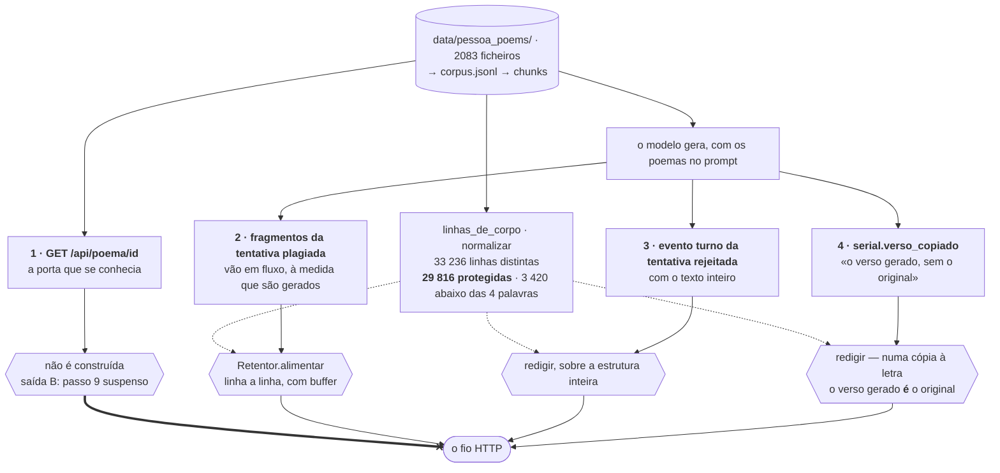
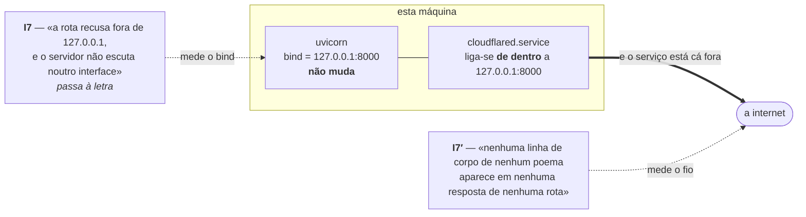
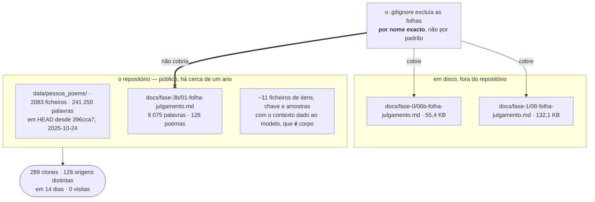

# The corpus, and the boundaries it can cross

```
┌─────────────────────────────────────────────────────────────────────────────────────────────┐
│ Name         corpus-fronteiras                                                              │
│ Type         Data-flow diagram with trust boundaries — three views                           │
│ Project      conversando_com_pessoa                                                         │
│ Description  Every path by which the body of a poem can leave this machine, and the control  │
│              on each: the four HTTP doors the I7′ sweep found, the boundary the tunnel moves │
│              without changing a byte of the bind, and the git remote — the exit that is      │
│              already open and that no control here touches. Drawn from `src/web/retencao.py`,│
│              `tests/test_i7.py`, `docs/EXPOSICAO-CORPUS.md` and `docs/PRODUCAO.md` §2.       │
└─────────────────────────────────────────────────────────────────────────────────────────────┘
```

The third recommendation of [`NOTACAO.md`](NOTACAO.md) §4, and the one with an undecided
question behind it: `EXPOSICAO-CORPUS.md` lists six options and the owner has taken none of
them. A diagram does not decide that. What it can do is put the two exits on one page, because
they are argued in different documents and the controls on one of them do nothing for the
other.

## 1. The four doors, and what stands in each

Fase 6 closed the body behind one route and guarded it with I7. The sweep found three more,
**all opened deliberately** by that phase and none of them a defect while the server answers
only `127.0.0.1`.



Door 2 is the one the dataflow projection cannot state and
[`turno-sequencia.md`](turno-sequencia.md) exists for: the fragments go out **as they are
generated**, so they leave before the plagiarism guard can reject the attempt. Measured before
the fix: **6 of 8 verses** of `poem_1104` on the wire. There is no downstream check that could
catch them, because they are already gone — which is why the control is in the transport and
not in the policy.

Door 4 is the subtlest. The comment said it carried the *generated* verse without the original,
which is true whenever the copy swaps a word — and false in exactly the case that matters.

**What is retained is the line, not the event.** The easy way to pass I7′ was to stop sending
the rejected attempt, which would have undone §4.4 and returned the user to 58 seconds with no
explanation. So `aprovado: false`, the verdict, the copied fraction and the list of copied
verses all still go, with the `verso` field empty where the verse was the corpus's own. The
explanation survives; the body does not. `test_i7.py` pins both halves, because protecting one
at the cost of the other is a regression and not a fix.

## 2. The boundary the tunnel moves without touching the bind



I7 used *«listens on `127.0.0.1`»* as a **measure of** *«not reachable from outside»*. The
tunnel separates the two: `cloudflared` runs on this machine and dials outward, so no flag is
set, no interface changes, the assertion passes literally, and the service is on the internet.
That is why the gate was rewritten to measure the thing it was protecting instead of the proxy
for it.

The sweep is the mechanism, not the retention. `ROTAS_COBERTAS` in `tests/test_i7.py` is the
gate: a new route that does not appear there fails the test. **Measured once, the day after it
was written** — `GET /api/health` from passo 3 broke this gate on the day it was born, before
any other test touched it.

> ⚠️ **Half of I7′ is not measurable yet, and that is written down rather than assumed.** The
> plan's assertion is «measured from outside, against the public URL», and there is no public
> URL. Until there is, the sweep runs against `uvicorn` and not against the tunnel, so it
> excludes neither an intermediary adding body (there is none in the design) nor a
> misconfiguration of the tunnel itself. Declaring the gate met here would be the same failure
> that got I7 rewritten.

## 3. The other exit, which no control above touches



The asymmetry is the finding, not the accident: deliberate work kept **16%** of the corpus body
out of a public repository while **100%** of it was already there, through the door next to it,
for a year. And the exclusion mechanism is the cause of the second failure — matching by exact
filename meant a later phase's sheet was never covered. Corrected to a pattern on 2026-10-19,
which covers future phases and **does not** unversion the ones already in.

**289 clones from 128 distinct origins in two weeks, with zero visits.** That permits one
conclusion and forbids two. It permits: the content is out, and no remedy that rewrites history
or flips the repository to private recovers what 128 origins already have. It does not permit
saying *who* — GitHub's clone metric includes the owner's own clones, CI and mirrors, and that
shape is typical of automated collection rather than people. It does not permit saying anything
about the year before the 14-day window, because GitHub keeps no more.

Removing `data/pessoa_poems/` would not clean §3's other eleven files either, because the
phases' *itens*, *chave* and *amostras* store the context handed to the model, and that context
**is** the body.

## 4. The two exits, side by side

| | the wire | the git remote |
|---|---|---|
| what crosses | generated text, per request | the corpus itself, once, and every clone since |
| the control | `Retentor` and `redigir`, with the sweep as the gate | the `.gitignore`, which matched by name |
| measured | 0 body lines across every covered route | 2083 files in `HEAD`, 289 clones from 128 origins |
| reversible | yes — nothing is stored | **no** |
| decided | yes, by measurement | **no** — `EXPOSICAO-CORPUS.md` §6, options A to F |

The left column is the one this project built machinery for. The right column is the one that
was already open while the machinery was being built.

## 5. What each claim rests on

| Claim | Held by |
|---|---|
| no route carries body in an approved answer | `test_i7_nenhuma_rota_leva_corpo_na_resposta_aprovada` |
| nor in the plagiarising attempt | `test_i7_nenhuma_rota_leva_corpo_na_tentativa_plagiada` |
| and the rejected attempt still reaches the wire | `test_i7_a_tentativa_rejeitada_continua_a_ir_ao_fio` |
| no route returns a poem body at all | `test_i7_nao_ha_rota_que_devolva_o_corpo_de_um_poema` |
| the static page carries none either | `test_i7_a_pagina_nao_leva_corpos` |
| **the sweep covers every route `criar_app` registers** | `test_i7_o_varrimento_cobre_todas_as_rotas` |
| the sweep actually bites | `test_i7_o_varrimento_morde` |
| the 4-word threshold is pinned by number | `test_i7_o_varrimento_ignora_linhas_curtas_e_isso_esta_medido` |

**And the sweep itself was once the defect.** Its first version split the wire on `\n` and
compared whole lines — correct for a file, wrong for NDJSON, where a verse's line break is the
two characters `\n` inside a JSON string. Split that way, a whole generation is six lines and a
verse inside one of them was never a line. **With the retention switched off in `app.py`, all
eight assertions stayed green.** It now matches by substring over two haystacks — the raw text
*and* every unescaped string of every event, joined with `\x00` so nothing matches across a
seam — at 19 ms per response. That is the third instrument defect `CONTROLO.md` §4 records in
this house, and the second in this gate.

It is worth saying plainly what that means for a diagram: the control in §1 is only as good as
the sweep, the sweep has been wrong once, and finding it wrong took deliberately breaking the
thing it was supposed to be watching.

All three Mermaid blocks were rendered at 10.9.1 before being committed.

## 6. Not drawn

The six options of `EXPOSICAO-CORPUS.md` §6, deliberately. They are a decision for the owner,
not a flow, and drawing them as a tree would make a diagram look like it was recommending one.
