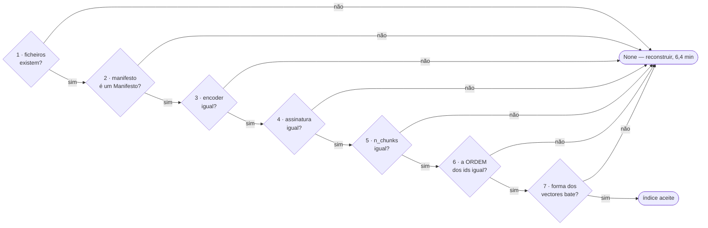

# The manifest, as a decision table

```
┌─────────────────────────────────────────────────────────────────────────────────────────────┐
│ Name         manifesto-decisao                                                              │
│ Type         Decision table — one rule, two implementations, and the test that joins them    │
│ Project      conversando_com_pessoa                                                         │
│ Description  Every way `Index.load` can refuse an index on disk, the parallel implementation │
│              in `estado.diagnosticar_indice` that exists to say WHICH check failed, and the  │
│              parity test that licenses the duplication — including one case it did not       │
│              cover, found while drawing this, verified by probe, and since closed.           │
└─────────────────────────────────────────────────────────────────────────────────────────────┘
```

From [`NOTACAO.md`](NOTACAO.md) §5. The rule is stated once in `src/retrieval/index.py` and
again in `src/web/estado.py`, and the second copy exists for a reason: `Index.load` returns
`None` and does not say why, which is fine for the pipeline and useless for gate I3 — *«índice
ausente ou desactualizado»* orders a 6,4-minute rebuild without saying what changed, when the
answer is one of seven and is sitting in the manifest.

Two copies of one rule diverge. The defence is not care; it is
`test_paridade_com_o_index_load`. This page is that rule in one place, so the two can be read
against each other without holding both files open.

## 1. The order, which is part of the rule



Seven exits, not five — the file's own docstring says *«qual dos **cinco** campos falhou»*,
and that counts the field comparisons without the two that come before them. The order is
deliberate on both sides: `diagnosticar_indice` says so in as many words — *«A ordem das
verificações é a do `Index.load`, de propósito: é o que faz o teste de paridade comparar a
mesma decisão e não uma parecida.»*

**Why the order check is the one that matters.** The ids are *positional*. An index is only
reusable together with the document order it was built from — without it, id *i* points at
nothing. That was the defect of the original `retriever.py`: it saved an index, never read it
back, and had it done so the arbitrary order of `os.listdir()` would have matched silently
wrong.

## 2. The table

| # | Condition | `Index.load` → refuse | `estado.diagnosticar_indice` → what it tells the user |
|---|---|---|---|
| 1 | either file missing | `return None` | `ausente: não há índice em disco` |
| 2 | manifest unreadable or not a `Manifesto` | `except (OSError, JSONDecodeError, TypeError)` | `ilegível: …`, or `manifesto sem o campo 'x'` on `KeyError` |
| 3 | `m.encoder != encoder.nome` | `return None` | `encoder diferente: o índice é de «x», o sistema usa «y»` |
| 4 | `m.assinatura != assinatura` | `return None` | `corpus mudou: a assinatura do corpus.jsonl não é a que gerou o índice` |
| 5 | `m.n_chunks != len(chunks)` | `return None` | `contagem diferente: o índice tem N, o corpus tem M` |
| 6 | `m.chunk_ids != [[poem_id, chunk_ix], …]` | `return None` | `ordem dos documentos mudou: os ids são posicionais` |
| 7 | `vectores.shape != (len(chunks), m.dim)` | `return None` | `forma dos vectores: (a,b), esperado (c,d)` |

### Three asymmetries that are deliberate

**Row 7 reads the `.npy` differently on each side.** `Index.load` does a full `np.load` — it is
about to use the vectors. `diagnosticar_indice` uses `mmap_mode="r"`, which reads the header and
leaves the 7,0 MB on disk, because **asking the state must not load anything**: if it did,
`/api/estado` would stop answering during a generation, which is exactly what gate I4 requires
of it.

**Row 7 compares `dim` against the manifest's own `dim`, not against `encoder.dim`.** A manifest
claiming a dimension its encoder does not have passes row 7 as long as its `.npy` agrees with
it. That is not a hole: row 3 catches it first, because a different dimension means a different
encoder and the encoder is compared by name. Worth stating, because the table otherwise reads as
though the encoder's dimension were checked, and it is not.

**Row 2 is one line on one side and two on the other.** `Manifesto(**json.load(f))` rejects a
manifest with an unexpected *or* a missing field, both as `TypeError`. The diagnosis reads a
raw `dict`, so a missing field surfaces as `KeyError` — and an **unexpected** field surfaces as
nothing at all. That is §4.

## 3. What licenses the duplication

```python
assert meu_ok is (dele is not None), f"divergência com o Index.load em {torcer}"
```

`test_paridade_com_o_index_load`, parametrised over six cases: the good index, and one twist
each for `encoder`, `assinatura`, `n_chunks`, `ids` and `dim`. Its docstring names which side
loses an argument, which is the part worth keeping: *«se divergirem, falha — e o que falha é o
diagnóstico, não o `Index.load`: a decisão de produção é dele.»*

Rows 1 and 2 are covered by `test_indice_ausente_e_ilegivel_distinguem_se`, but **only on the
diagnosis side** — that test never calls `Index.load`. So the parity assertion covers rows 3
to 7 and the good case, and rows 1 and 2 are each tested once, separately, against one
implementation.

## 4. One case the parity test did not cover

Found while drawing this table, and verified by probe rather than reasoned at:

| manifest | `diagnosticar_indice` | `Index.load` | |
|---|---|---|---|
| good | `True` | loads | agree |
| **one field too many** | **`True` — «2 chunks · …»** | **`None`** | **diverge** |
| one field missing | `False` — `manifesto sem o campo 'dim'` | `None` | agree |

`Manifesto` is a plain dataclass, so `Manifesto(**m)` raises `TypeError` on an unexpected
keyword and `Index.load` refuses. The diagnosis reads the dict by key, finds every key it wants,
and reports a healthy index.

**Which way it fails matters.** The diagnosis is the optimistic side: `/api/estado` would show
the index ready, gate I3 would be satisfied, and every question would then rebuild for 6,4
minutes — the interface asserting health about the one component that is about to cost the user
the longest wait in the system.

**And it is reachable, by a path this repository already built.** `instalar.copiar_artefactos`
copies `data/index.manifest.json` from the work checkout into the service checkout, and
`instalar.recuar` moves the service checkout back to an older tag (passo 8, gate D6). Roll the
code back past a commit that added a field to `Manifesto`, keep the newer artifacts, and the
manifest on disk has a field the code does not know. **`instalar.manifesto_aceite` — the check
D6 runs *before* restarting — calls `diagnosticar_indice`**, which is the side that says yes.

**Closed on 2026-10-21**, in the commit after this document: `estado._como_manifesto` now
builds the manifest with `Manifesto(**m)` like the other side does, and
`test_paridade_com_o_index_load` gained the `{"extra": …}` case. The sentence that stood here —
*«neither is done here, this branch draws the table and does not touch `src/`»* — was true of
the branch that drew the table, and is kept in that shape because the order mattered: the
divergence was measured before anything was changed.

The new case was checked against the **old** `estado.py` before being trusted: it fails with
`divergência com o Index.load em {'extra': {'versao': 2}}`, and the message test fails too. A
case that passes either way would have been worse than no case.

## 5. What each claim rests on

| Claim | Held by |
|---|---|
| the diagnosis names the field that diverged | `test_diz_qual_campo_do_manifesto_divergiu` (4 cases) |
| absent and unreadable are distinguished | `test_indice_ausente_e_ilegivel_distinguem_se` |
| a good index is accepted and described | `test_indice_bom_e_aceito_e_diz_o_que_tem` |
| **the two implementations agree** | `test_paridade_com_o_index_load` (6 cases) |
| the diagnosis compares against the encoder the system uses | `test_o_diagnostico_compara_contra_o_encoder_que_o_sistema_usa` |
| asking the state loads nothing | `tests/test_app.py`, gate I3; and `test_i4_o_estado_responde_durante_uma_geracao` |
| the extra-field divergence | `test_paridade_com_o_index_load[torcer6]` and `test_diz_qual_campo_do_manifesto_divergiu[…campo a mais]`, both added after §4 measured it |

The Mermaid block was rendered at 10.9.1 before being committed, and the §4 table is the output
of a probe run against this repository's own `Index.load` and `diagnosticar_indice`, not a
reading of them.
