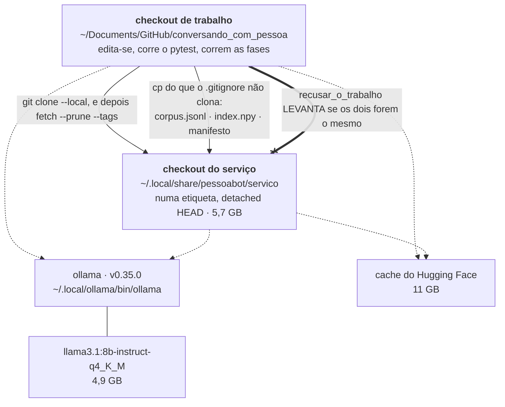
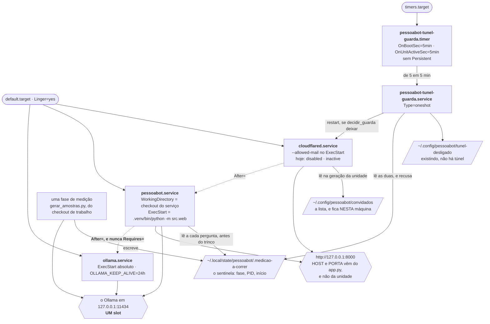
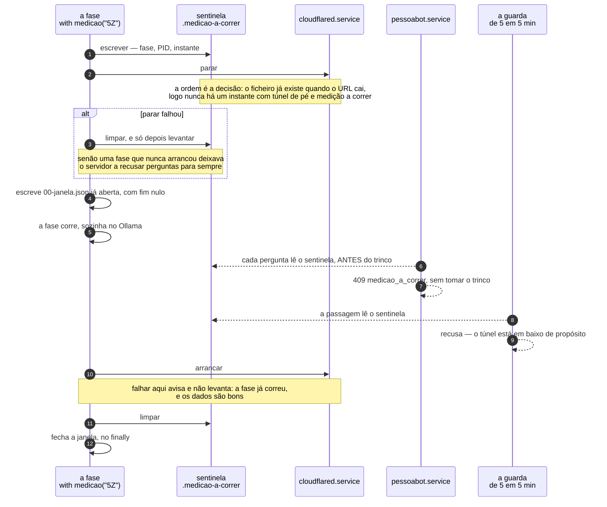

# The service, as it sits on the machine

```
┌─────────────────────────────────────────────────────────────────────────────────────────────┐
│ Name         servico-topologia                                                              │
│ Type         Topology diagram — placement and dependency, plus one sequence for the window   │
│ Project      conversando_com_pessoa                                                         │
│ Description  Where the public service actually lives: two checkouts and why that is a        │
│              correctness property, five user units and the dependencies they deliberately    │
│              do not declare, three state files outside every checkout, and the single        │
│              Ollama slot the service and a measurement phase have to take turns on.          │
│              Drawn from `src/web/unidades.py`, `instalar.py`, `tunel.py`, `sentinela.py`,    │
│              `saude.py` and `docs/producao/SERVICO.md`.                                      │
└─────────────────────────────────────────────────────────────────────────────────────────────┘
```

The second recommendation of [`NOTACAO.md`](NOTACAO.md) §3. `docs/producao/SERVICO.md` is 11 KB
of prose read off the machine, and the facts in it are **positional** — which checkout is
running, which is being edited, where the state lives, which unit waits for which and how
loosely. Prose carries that badly, and three of the positions are asserted in code rather than
merely observed.

## 1. The machine

Two views, because one graph of all of it crossed four groups at once and read as a tangle.

### 1.1 The two checkouts



Each has its own `.venv` and its own `data/`. What they share is what is expensive and
immutable, which is why `~/.local/ollama` is outside both.

### 1.2 The units, and the state they read



The units live in `~/.config/systemd/user/` and are generated by `src/web/unidades.py`, never
written by hand: the paths in them are absolute and belong to *this* machine, so a versioned
`.service` file with `/home/mpb/...` inside is one nobody can test. `Linger=yes` is what makes
any of it survive closing the graphical session — without it, `enable --now` gives a service
that runs today and does not come back tomorrow.

### The two edges that are decisions, not plumbing

**`After=` and never `Requires=`.** Drawn dotted above because that is the whole point. The
`/api/estado` was designed to report «Ollama em baixo» *with the remedy*, and gate I3 measures
it; with `Requires=`, a failed Ollama would take down the one page that could explain the
failure. A rigid dependency would undo a measured decision.

**`recusar_o_trabalho` is drawn as a refusal**, because installing the service over the work
checkout is the one mistake a distracted install makes with a default argument — and a public
URL would then serve whatever is half-written, across a `git switch` in the middle of a phase.

## 2. The window: one slot, and an order that does not invert

The lock in `app.py` is an `asyncio.Lock`, so it is per process. It does nothing about a
`gerar_amostras.py` talking to the same Ollama from the other checkout — and that is the
expensive failure, because the phase's `segundos` field becomes uninterpretable without saying
so. The interlock between processes is the sentinel, and `sentinela.medicao(...)` is what makes
it a mechanism instead of discipline.



Step 2 before step 13 is not a style choice. **Verified by mutation** in
`tests/test_sentinela.py`: with the two swapped, the order test fails. Invert it and you open
exactly the window the mechanism closes — a request arriving in it generates against the
phase's Ollama.

The guard's refusal at step 11 is the second of its four, and the first exists because the
guard once resurrected a tunnel its owner had switched off: `systemctl --user restart` starts a
disabled unit. `disable` removes it from boot; it does not lock it. So an automatic mechanism
spent five-minute intervals undoing a decision taken on a measurement, which is the family of
defect this whole plan chases.

## 3. The four refusals that hold the shape

None of these is a convention. Each one raises, and each has a test.

| Refusal | What it prevents | Where |
|---|---|---|
| `recusar_o_trabalho` | the service serving the checkout where code is being edited | `unidades.py` |
| `ler_convidados` → `ListaVazia` | a tunnel unit generated **without** `--allowed-mail`, which is a tunnel open to the world with the corpus behind it | `unidades.py` |
| `tunel-desligado` beats the guest list | a reinstall quietly reopening a door closed on a measured defect | `instalar.py:decidir_tunel` |
| `_exigir_conhecida` before `stop` | `systemctl --user stop` of a **nonexistent** unit returns 0 — "tunnel stopped" with the URL still up | `tunel.py` |

The last one is the sharpest: the mechanism that protects the measurements would have reported
success while leaving the public on the same chip.

## 4. The state today, with provenance

From `docs/producao/SERVICO.md`, which was written from the machine.

| | | provenance |
|---|---|---|
| the service answers at | `http://127.0.0.1:8000` | `curl` |
| public URL | **none** | §7.5 of the plan |
| tag running | `servico-2026-10-20c` | `/api/health` |
| `sha` running | `aa15dd4` | `/api/health` |
| `ollama.service`, `pessoabot.service` | `enabled · active` | `systemctl --user` |
| `cloudflared.service`, the `.timer` | **`disabled · inactive`** | idem |

There is no public URL because a Protected Quick Tunnel keeps an authenticated session for
**4 seconds** ([`cloudflared#1752`](https://github.com/cloudflare/cloudflared/issues/1752),
open). The reason is written in `~/.config/pessoabot/tunel-desligado`, and that file is what
stops any reinstall from reopening it.

## 5. What each claim rests on

| Claim | Held by |
|---|---|
| every `ExecStart` is absolute, and no unit invokes a `PATH` name | `test_d2_os_execstart_sao_absolutos`, `test_d2_nenhuma_unidade_invoca_um_nome_do_path` |
| the service waits for Ollama and does **not** depend on it | `test_d2_o_servico_espera_o_ollama_e_nao_depende_dele` |
| no unit names the work checkout | `test_d2_nenhuma_unidade_nomeia_o_checkout_de_trabalho`, `test_recusar_o_trabalho_recusa_exactamente_o_trabalho` |
| the unit declares neither interface nor port | `test_i7_a_unidade_nao_declara_interface_nem_porta` |
| no guest list means no tunnel, as an exception | `test_d4_sem_lista_nao_ha_tunel_e_isso_e_uma_excepcao`, `test_d4_a_unidade_do_tunel_recusa_nascer_sem_convidados` |
| the switch beats a list that has guests in it | `test_o_tunel_desligado_ganha_a_uma_lista_com_convidados` |
| the sentinel path is absolute and outside every checkout | `test_i8_o_caminho_por_omissao_e_absoluto_e_fora_de_qualquer_checkout`, `test_i8_com_o_caminho_relativo_da_especificacao_fica_invisivel` |
| one checkout's phase is seen by the other's server | `test_i8_a_fase_de_um_checkout_e_vista_pelo_servidor_do_outro` |
| **never an instant with the tunnel up and a measurement running** | `test_d3_nunca_ha_um_instante_com_tunel_de_pe_e_medicao_a_correr` |
| a phase that fails to start leaves no refusing server | `test_d3_uma_fase_que_nao_arranca_nao_deixa_o_servidor_recusado` |
| the guard resurrects neither a switched-off tunnel nor one down for a measurement | `test_a_guarda_nao_ressuscita_um_tunel_que_alguem_mandou_parar`, `test_a_guarda_nao_levanta_o_tunel_no_meio_de_uma_medicao` |
| a nonexistent unit fails instead of claiming it stopped | `test_uma_unidade_que_nao_existe_falha_em_vez_de_dizer_que_parou` |
| the `sha` is the service checkout's, not the cwd's, and is read once | `test_d1_o_sha_e_do_checkout_do_servico_e_nao_do_cwd`, `test_d1_o_sha_nao_se_le_por_pedido` |
| linger is required, and a clean boot proves nothing about a logout | `test_d2_sem_linger_as_duas_metades_falham`, `test_d2_um_arranque_limpo_nao_prova_nada_sobre_o_logout` |

Both Mermaid blocks were rendered at 10.9.1 before being committed.

## 6. What is not drawn

- **`GET /api/poema/{id}`** — not built; Fase 6 passo 9 is suspended by the saída B of
  `PRODUCAO.md`.
- **`data/sessoes.db`** — not built either; Fase 6 passo 8. The ER diagram in `FASE-6.md`
  describes it anyway.
- **The egress surface of the poem body.** That is the third recommendation of
  [`NOTACAO.md`](NOTACAO.md) §4 and wants a trust-boundary diagram, not this one: here
  `cloudflared.service` is a box that connects outward from inside, and the point of that
  diagram is that this is exactly why gate I7 passed literally while being defeated.

Not generated, and nothing keeps it in sync with the machine: if a unit changes, this changes by
hand.
