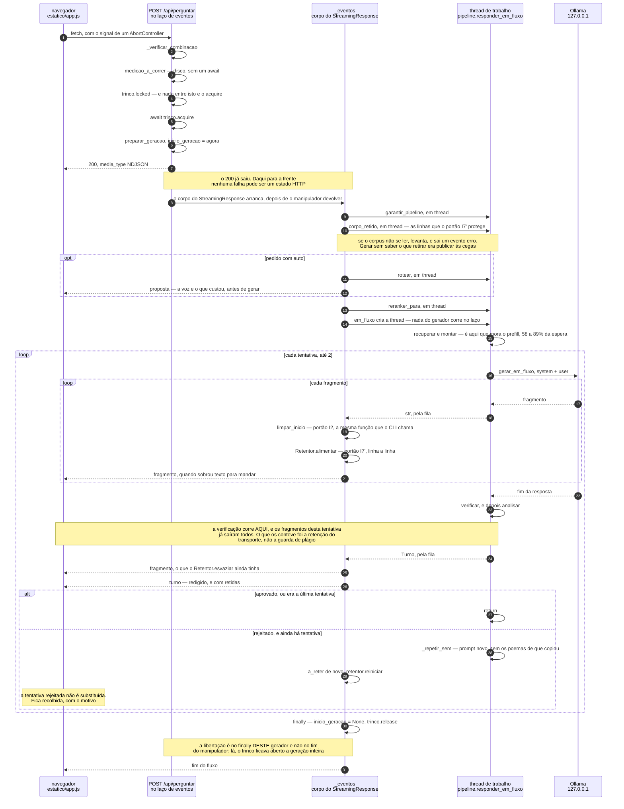
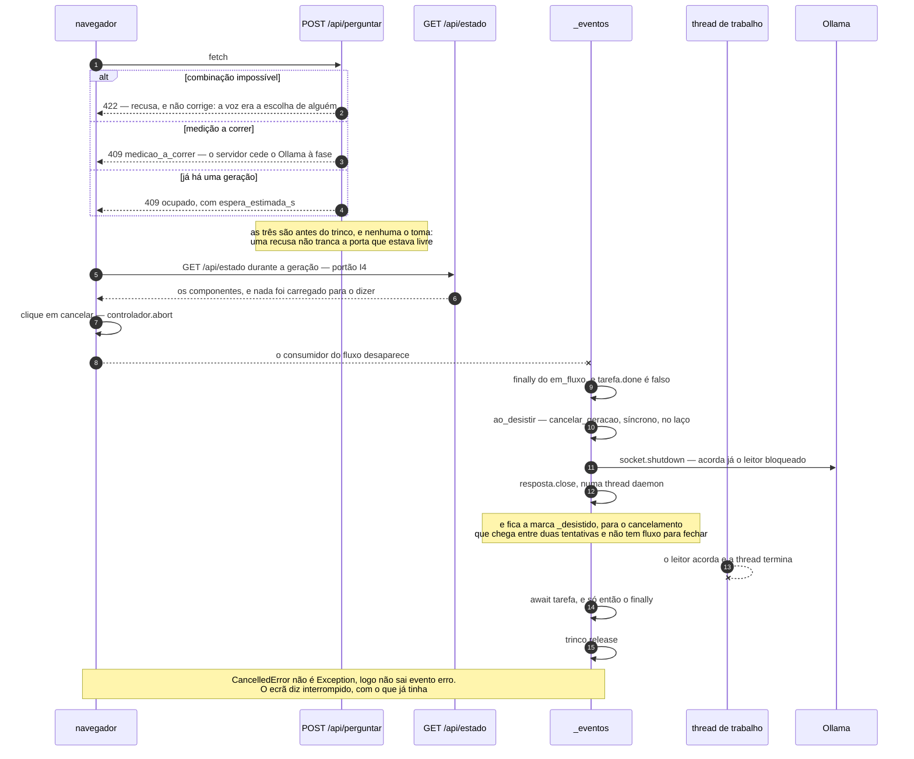

# One turn, in time

```
┌─────────────────────────────────────────────────────────────────────────────────────────────┐
│ Name         turno-sequencia                                                                │
│ Type         Sequence diagram — five lifelines, two views (the turn, and the refusals)       │
│ Project      conversando_com_pessoa                                                         │
│ Description  `POST /api/perguntar` as it happens: who holds the lock, when the 200 is gone,  │
│              which retention catches a verse before it leaves, and the fact the dataflow     │
│              projection cannot state — that the plagiarism guard runs after the fragments    │
│              of its own attempt have already gone out. Drawn from `src/web/app.py`,          │
│              `fluxo.py`, `cancelar.py`, `retencao.py`, `pipeline.py` and `estatico/app.js`.  │
└─────────────────────────────────────────────────────────────────────────────────────────────┘
```

Why a sequence diagram and not another graph: [`pessoa-rag.flow.ts`](pessoa-rag.flow.ts) draws
`gerar → verificarPersona → detectarPlagio → decidir`, which is true of `src/pipeline.py` and
not of the wire. A dataflow edge is a data dependency; it has no way to say that the guard is
downstream in the *dataflow* and not downstream in *time*. That distinction is the whole I7′
finding, and it is step 23 of §1 below. The argument is in [`NOTACAO.md`](NOTACAO.md) §2.

## 1. The turn



## 2. The refusals, and giving up



## 3. What each claim rests on

Nothing here is drawn from the plan. Each row is a line of code and the test that holds it. The
step numbers are the diagrams' own `autonumber`, with the label beside them so an edit that
renumbers the diagram does not silently break the reference.

| Step | Claim | Code | Held by |
|---|---|---|---|
| §1 · 2 `_verificar_combinacao` | the impossible combination is refused, not corrected | `app.py:_verificar_combinacao` | `test_a_combinacao_impossivel_e_recusada_e_nao_corrigida` |
| §1 · 3–5 sentinel, `locked`, `acquire` | the sentinel comes first, and nothing runs between the check and the take | `app.py:perguntar` | `test_a_segunda_geracao_concorrente_recebe_409_com_a_espera` |
| §1 · 7–8 the `200`, then the body | after this a failure can only be an event, never a status | `StreamingResponse(_eventos(...))` | `test_uma_falha_na_geracao_liberta_o_trinco_e_vai_ao_fio` |
| §1 · 10 `corpo_retido` | the retained lines are read **before** a single token is generated, and failing to read them stops the turn | `Servico.corpo_retido` | `tests/test_i7.py` (8 tests) |
| §1 · 12 `proposta` | the proposal precedes the fragments, and generation does not wait on a dialog | `_eventos`, §4.5 | `test_o_auto_emite_a_proposta_antes_dos_fragmentos` |
| §1 · 19 `limpar_inicio` | the presentation retention is the CLI's own function, not a second copy of the policy | `apresentacao.limpar_inicio` | `test_i2_a_retencao_usa_a_funcao_do_cli_e_nao_uma_copia` |
| §1 · 23 `verificar, e depois analisar` | **the guard runs after the fragments of its own attempt have already gone out** — step 21 precedes it | `pipeline.py:239` vs `pipeline.py:243–244` | `tests/test_i7.py`, `src/web/retencao.py` |
| §1 · 26 `turno` | the rejected attempt reaches the wire and is not replaced on screen | `_eventos`, §4.4 | `test_i1_a_tentativa_rejeitada_vai_ao_fio_e_nao_e_substituida` |
| §1 · 29 `retentor.reiniciar` | both retentions are re-armed per attempt — the CLI does **not** do this | `buffer, a_reter = [], True` | `test_i2_o_preambulo_e_o_eco_nao_chegam_ao_fio` |
| §1 · 30 `finally` | released in the generator's `finally`, not at handler return | `app.py:543–544` | `test_o_trinco_fica_livre_depois_de_cada_geracao` |
| §2 · 5–6 `/api/estado` | the state answers mid-generation, and loads nothing to do it | `estado.py`, gate I4 | `test_i4_o_estado_responde_durante_uma_geracao` |
| §2 · 7–13 the abort | giving up stops Ollama, and does not merely free the screen | `cancelar.py:interromper` | `test_i5_depois_do_abort_o_ollama_nao_esta_a_decodificar`, `test_i5_o_trinco_fica_livre_e_a_pergunta_seguinte_arranca_em_menos_de_2s` |
| §2 · 10–12 `_desistido` | the mark catches a cancel that arrives between two attempts, with no open stream to close | `GeradorCancelavel.cancelar` | `test_cancelar_entre_duas_tentativas_apanha_a_tentativa_seguinte` |
| §2 · 15 `trinco.release` | the cancel path frees the lock too, since `CancelledError` misses the `except` | `_eventos` `finally` | `test_i5_o_fluxo_cancelado_nao_deixa_o_servidor_avariado` |

Both diagrams were rendered with Mermaid 10.9.1 before being committed, so the syntax is
checked and not assumed.

## 4. Where this should live

Here, because this folder is where analysis of this project lands. If it is adopted, its place
is next to [`docs/FASE-6.md`](../FASE-6.md) §4.4, which argues step 24 in prose three times, and
beside §2 of [`docs/PRODUCAO.md`](../PRODUCAO.md), which argues step 20. Like everything else in
this folder it is **not generated** and nothing keeps it in sync with the Python: if the event
order changes, this changes by hand.

Known omission, deliberate: `GET /api/poema/{id}` is not drawn, because it is not built —
Fase 6 passo 9 is suspended by the saída B of `PRODUCAO.md`.
