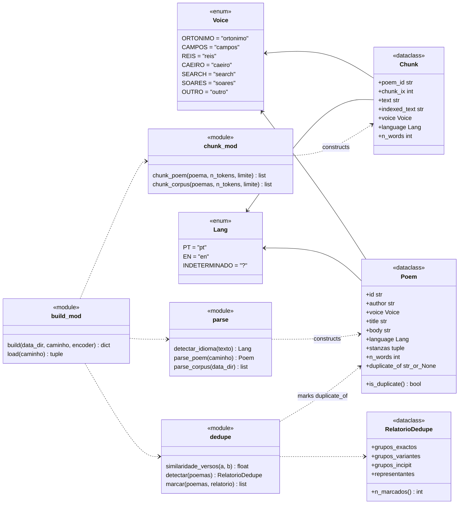
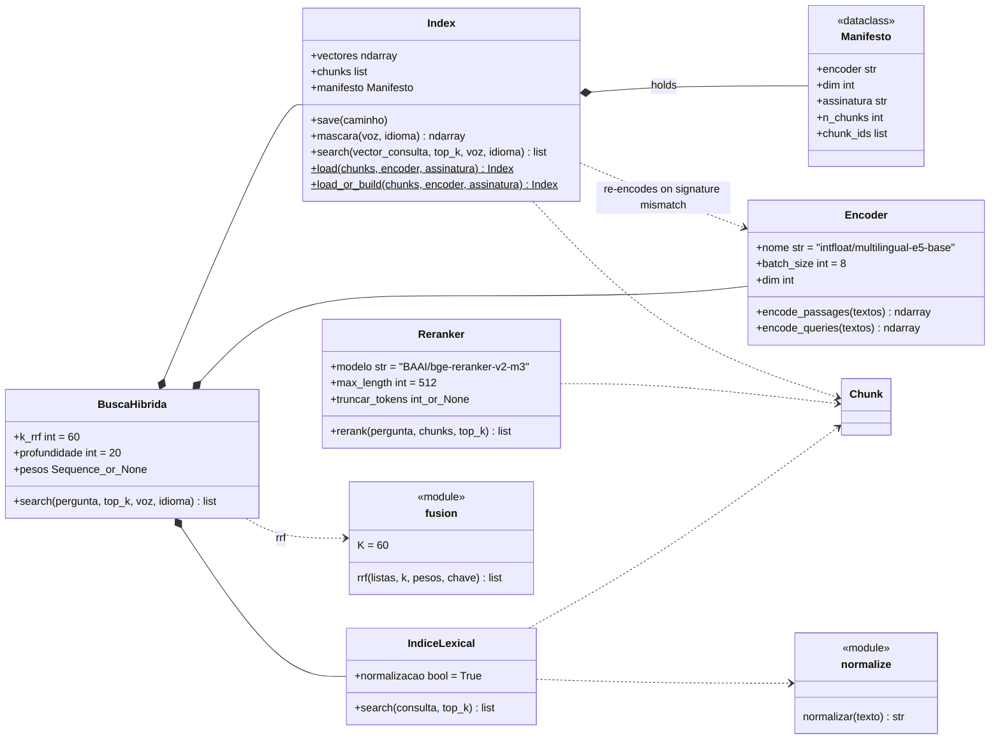
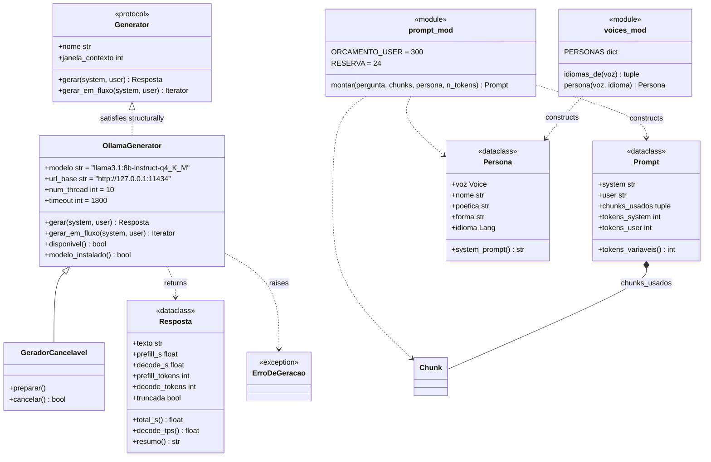
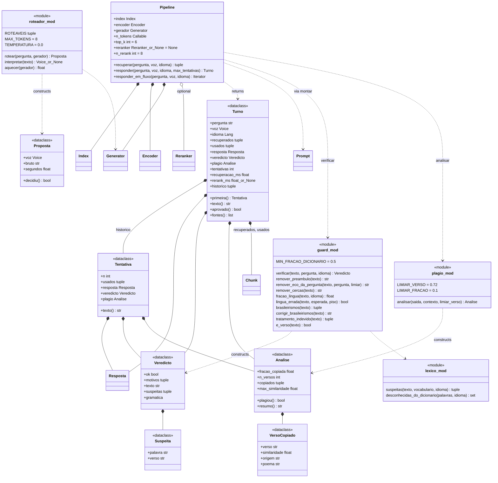
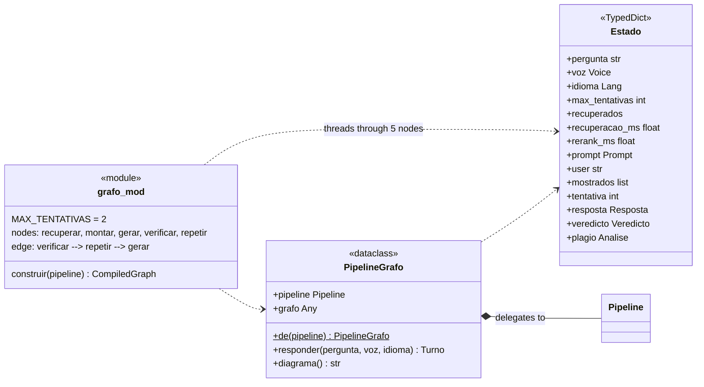
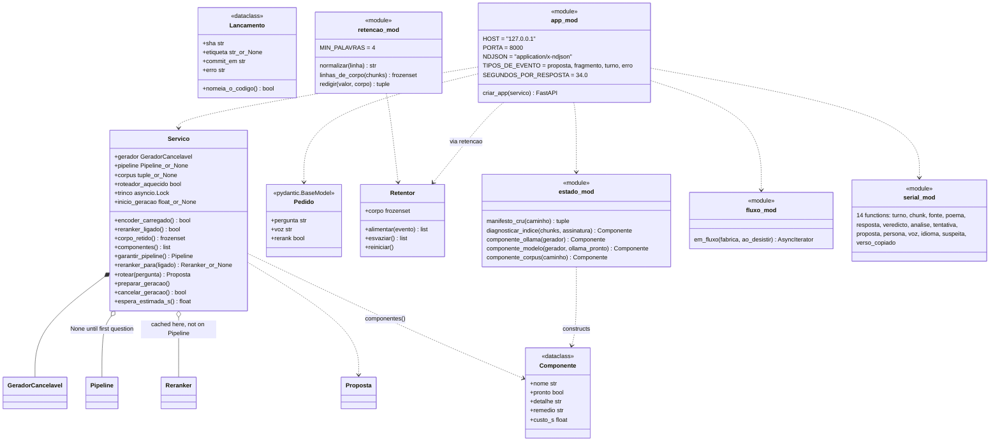
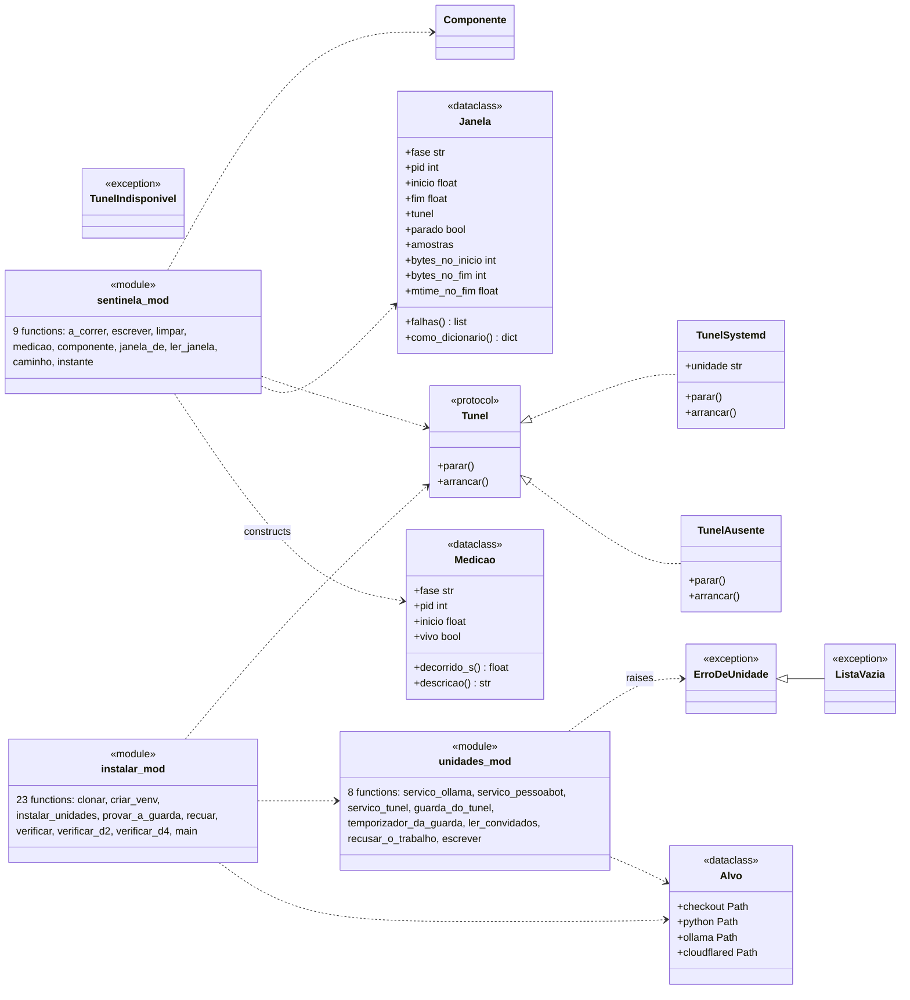
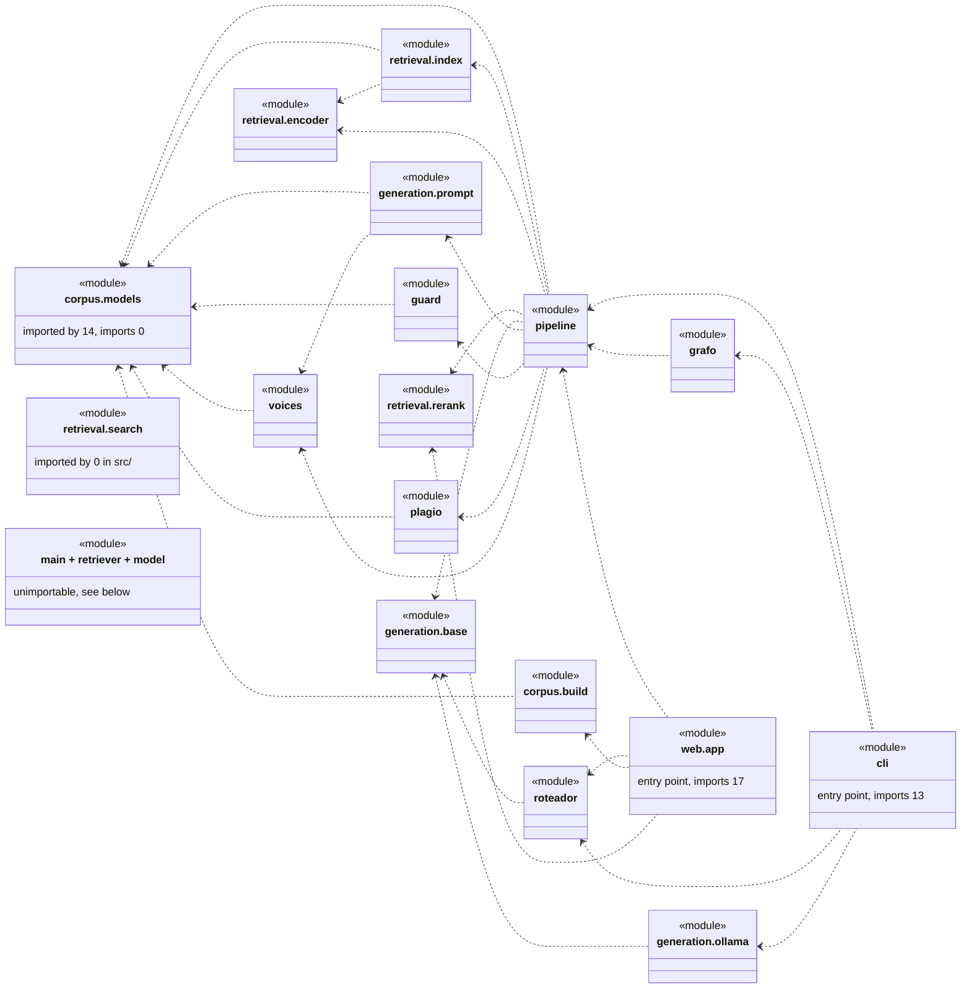

# The static structure of `src/`

```
┌─────────────────────────────────────────────────────────────────────────────────────────────┐
│ Name        uml-class-diagram                                                               │
│ Type        UML class diagram — Mermaid `classDiagram`, eight views                         │
│ Project     conversando_com_pessoa                                                          │
│ Description The static structure of this project's own Python under `src/`: 46 classes, 110 │
│             module-level functions, 38 modules that hold anything. Extracted by importing   │
│             every module and asking `inspect` and `dataclasses.fields`, not by reading the  │
│             source, so the member lists and the bases are the interpreter's own answer. The │
│             shape it found is flat — 22 of the 46 classes are dataclasses and exactly one   │
│             pair is related by inheritance — and this document says so instead of dressing  │
│             110 functions up as methods.                                                    │
└─────────────────────────────────────────────────────────────────────────────────────────────┘
```

## 0. What the extraction actually found

This document was not written by reading `src/`. A script imported all 45 Python files
under it and asked the interpreter what was there — `inspect.isclass`,
`dataclasses.is_dataclass`, `dataclasses.fields`, `issubclass(…, Enum)`,
`cls.__bases__`, `_is_protocol`. The command is in §7. The answer:

| | count |
|---|---|
| modules holding at least one class or function | 38 |
| classes | 46 |
| of those, `@dataclass` | 22 |
| plain classes (hand-written `__init__`) | 15 |
| exceptions | 5 |
| `StrEnum` | 2 |
| `typing.Protocol` | 2 |
| module-level functions | 110 |
| inheritance edges between two of this project's own classes | **1** |

**So this is not an object-oriented codebase, and these diagrams should not pretend it
is.** It is a set of frozen record types with 110 free functions operating on them. The
one inheritance edge between two classes written here is
`GeradorCancelavel --|> OllamaGenerator`; every other base class is from the standard
library or a dependency (`StrEnum`, `Protocol`, `dict`, `RuntimeError`,
`pydantic.BaseModel`). The abstraction that does the work is not a base class, it is the
`Generator` protocol — structural, never inherited from by anything in `src/`.

Where a diagram below shows a box for something that is not a class, it carries the UML
stereotype that says what it really is: `«dataclass»`, `«enum»`, `«protocol»`,
`«exception»`, or `«module»` for a file whose whole content is functions. The dependency
arrows between `«module»` boxes are real `import` statements, read out of the AST, not
judgements about what belongs with what.

Two modules could not be imported at all, which is itself a finding — see §6.

## 1. `src/corpus` — the record types everything else passes around

Four types in `src/corpus/models.py` are the vocabulary of the whole project: `Voice` and
`Lang` appear in almost every signature, and `Chunk` is the unit that is indexed,
retrieved, put in a prompt and compared against for plagiarism. Nothing here has a
method worth the name — `Poem.is_duplicate` is a property over one field.



`chunk_mod` and `build_mod` are the files `src/corpus/chunk.py` and `src/corpus/build.py`;
they are renamed in the diagram only because `chunk` and `build` collide with the names
of the functions inside them.

## 2. `src/retrieval` — and the one class that nothing in `src/` uses



**`BuscaHibrida` is imported by no module in `src/`.** `grep` for its importers finds
`tests/test_retrieval_gold.py` and nothing else; the AST import graph of `src/` has no edge
into `src.retrieval.search` at all. The live query path is §4's `Pipeline.recuperar`, and
that method — printed with `inspect.getsource`, §7 — calls `encoder.encode_queries`, then
`index.search`, then optionally `reranker.rerank`. There is no BM25 and no reciprocal-rank
fusion on the path a user's question takes.

This matters because [`pessoa-rag.flow.ts`](pessoa-rag.flow.ts) in this same folder
describes the query half as "retrieve densely and lexically, fuse by reciprocal rank".
That is true of `src/retrieval/search.py`, which exists, is tested, and is never called;
it is not true of `src/pipeline.py`, which answers the questions. `IndiceLexical`,
`fusion.rrf` and `normalize.normalizar` are reachable only from `tests/`.

## 3. `src/generation`, `src/voices`, `src/web/cancelar` — the one protocol and the one subclass



`Generator <|.. OllamaGenerator` is drawn dashed on purpose: `OllamaGenerator` does not
name `Generator` among its bases (`OllamaGenerator.__bases__` is empty after `object`),
and the protocol is never inherited. The relation is structural, checked by the type
checker and by the fact that `Pipeline` accepts anything with those four members — which
is how `tests/` substitute a fake generator without a model.

`GeradorCancelavel --|> OllamaGenerator` is the **only** inheritance edge in this
repository between two classes defined in it. It adds two methods and no state beyond one
per-request attribute, so the subclass exists to hold a handle that can be closed when a
browser disconnects, not to specialise behaviour.

## 4. `src/` root — the orchestration, and where the records accumulate



Two things in this view are worth naming because a tidier drawing would lose them.

`Turno` is a **record of the whole turn including its failures**: `historico` is a tuple of
`Tentativa`, each with its own `Resposta`, `Veredicto` and `Analise`. The retry loop in
`Pipeline.responder` runs at most `MAX_TENTATIVAS = 2` times, and a rejected attempt is
kept rather than discarded. `Turno.resposta` is the last attempt; `Turno.primeira` is the
first.

The guards are `«module»` boxes with eleven and one function because that is what they
are. `src/guard.py` holds `Veredicto` plus eleven free functions and no class to put them
on; `verificar` is a pipeline of the other ten. Drawing it as a `Guard` class with eleven
methods would be a nicer picture of code that does not exist.

### The same thing again, as a state graph

`src/grafo.py` re-expresses `Pipeline.responder` as a LangGraph. The node names were read
out of `construir`'s own `add_node` calls:



`Estado` subclasses `dict` — it is a `TypedDict`, so its 14 keys are annotations, not
attributes, and nothing enforces them at runtime. The five nodes plus the
`verificar → repetir → gerar` back edge are the same control flow as the `for` loop in
`Pipeline.responder`; `PipelineGrafo` holds a `Pipeline` and calls into it, so this is a
second front end on one implementation rather than an alternative one.

## 5. `src/web` — the service, and the only `Protocol` with more than one implementation



`src/web/serial.py` is fourteen functions and zero classes: one per record type in §1–§4,
each turning it into a `dict` for the wire. It is the clearest case in the repository of
behaviour that an object-oriented design would have put on the types themselves — a
`to_dict` on each dataclass — and that this project deliberately keeps outside them, so
`src/corpus/models.py` does not know that a web service exists.

The reranker is cached on `Servico`, not on `Pipeline`: a request that asks for `rerank:
false` detaches it from the pipeline, and detaching cannot mean reloading 568 MB the next
time someone asks for it.

### The deployment side, and the second protocol



`Tunel` is the only `Protocol` in the repository with two implementations, and they are
`TunelAusente` (does nothing) and `TunelSystemd` (shells out to `systemctl --user`). Like
`Generator`, neither names the protocol as a base. `ErroDeUnidade <|-- ListaVazia` is the
second and last inheritance edge between two classes written here, and both are
exceptions, which is the one place the language gives no alternative.

## 6. The module dependency graph, and the two modules that do not import

Read out of the AST of all 45 files: 24 modules import at least one other module of this
project, 117 intra-`src` import edges. `src/corpus/models.py` is imported by 14 of them
and imports nothing, which is what makes it the vocabulary.



`retrieval.search` has no incoming edge, as §2 said. Three more modules have none either
and are entry points or test-only helpers rather than dead code: `cli`, `web.instalar`,
`web.__main__`, `web.serial` (imported by `app` dynamically inside the handler),
`avaliacao` (used by `tests/test_retrieval_gold.py`).

**And then there is the legacy prototype.** Two modules under `src/` could not be imported
at all:

| module | what happens | why |
|---|---|---|
| `src/main.py` | `ModuleNotFoundError: No module named 'model'` | line 2 is `from retriever import PessoaRetriever` — a flat import, so the file only resolves if `src/` itself is on `sys.path`, which `pessoa` and `python -m src.cli` never arrange |
| `src/retriever.py` | `ModuleNotFoundError: No module named 'faiss'` | it imports `faiss`, which is not in this project's `.venv` |

These three files — `main.py`, `retriever.py`, `model.py` — are the pre-`src/corpus`
prototype: `model.py`'s `PessoaModel` wraps `google/flan-t5-large`, not Ollama, and
`src/corpus/build.py`'s own docstring refers to "the old `retriever.py`" in the past tense.
Nothing on the live path imports them, `src/main.py` cannot be imported under the layout
the project actually uses, and `src/retriever.py` cannot be imported at all with the
installed dependencies. Their structure is therefore **unverified** — `PessoaModel`'s
members in §no-diagram come from `src/model.py`, which does import cleanly; `retriever.py`
was never loaded and is not drawn.

## 7. Reproducing this extraction

Everything counted and listed above came out of these two commands, run from the
repository root with the project's own `.venv`. Neither needs Ollama, a model, or the
index.

The classes, their stereotypes, bases, dataclass fields, enum members, methods and
properties:

```bash
PYTHONPATH=. .venv/bin/python - <<'EOF'
import importlib, inspect, dataclasses, enum, json, pathlib
mods = []
for p in sorted(pathlib.Path("src").rglob("*.py")):
    n = ".".join(p.with_suffix("").parts).removesuffix(".__init__")
    if not n.endswith(".__main__"):
        mods.append(n)
for m in mods:
    try:
        mod = importlib.import_module(m)
    except Exception as e:
        print(f"{m}: ERROR {type(e).__name__}: {e}")
        continue
    for n, o in vars(mod).items():
        if n.startswith("_"):
            continue
        if inspect.isclass(o) and o.__module__ == m:
            kind = [k for k, t in (("dataclass", dataclasses.is_dataclass(o)),
                                   ("enum", issubclass(o, enum.Enum)),
                                   ("protocol", getattr(o, "_is_protocol", False)),
                                   ("exception", issubclass(o, BaseException))) if t]
            bases = [b.__name__ for b in o.__bases__ if b is not object]
            print(f"{m}.{n} kind={kind} bases={bases}")
            if dataclasses.is_dataclass(o):
                print("   fields:", [f.name for f in dataclasses.fields(o)])
            if issubclass(o, enum.Enum):
                print("   members:", [(e.name, e.value) for e in o])
        elif inspect.isfunction(o) and o.__module__ == m:
            print(f"{m}.{n}() {inspect.signature(o)}")
EOF
```

The import graph of §6, and the two methods quoted in §2 and §4:

```bash
PYTHONPATH=. .venv/bin/python - <<'EOF'
import ast, pathlib, collections, inspect
local = {".".join(p.with_suffix("").parts).removesuffix(".__init__")
         for p in pathlib.Path("src").rglob("*.py")}
edges = collections.defaultdict(set)
for p in sorted(pathlib.Path("src").rglob("*.py")):
    name = ".".join(p.with_suffix("").parts).removesuffix(".__init__")
    pkg = name.rsplit(".", 1)[0] if "." in name else name
    for n in ast.walk(ast.parse(p.read_text())):
        if isinstance(n, ast.ImportFrom):
            base = pkg if n.level == 1 else pkg.rsplit(".", max(n.level - 1, 0))[0]
            tgt = (f"{base}.{n.module}" if n.module else base) if n.level else (n.module or "")
            if tgt.startswith("src"):
                edges[name].add(tgt)
imported = {t for v in edges.values() for t in v}
print("edges:", sum(len(v) for v in edges.values()),
      "modules importing something local:", len(edges))
print("no incoming edge:", sorted(local - imported))
from src.pipeline import Pipeline
print(inspect.getsource(Pipeline.recuperar))
EOF
```

The counts in §0 are the output of the first command tallied by stereotype; the
"imported by 14" on `corpus.models` is the number of distinct keys in the second
command's `edges` whose value contains `src.corpus.models`.

## What this document is not

It is a drawing of `src/` as it stood at the commit that added it, made by running the
code, and nothing keeps it in sync. The same caveat as the rest of this folder applies:
twowayflow's one architectural rule is that the code on disk is the only source of truth,
and this file is not that code. When `src/` changes, this has to be redrawn by hand — but
§7 is the recipe, and re-running it takes a few seconds.
