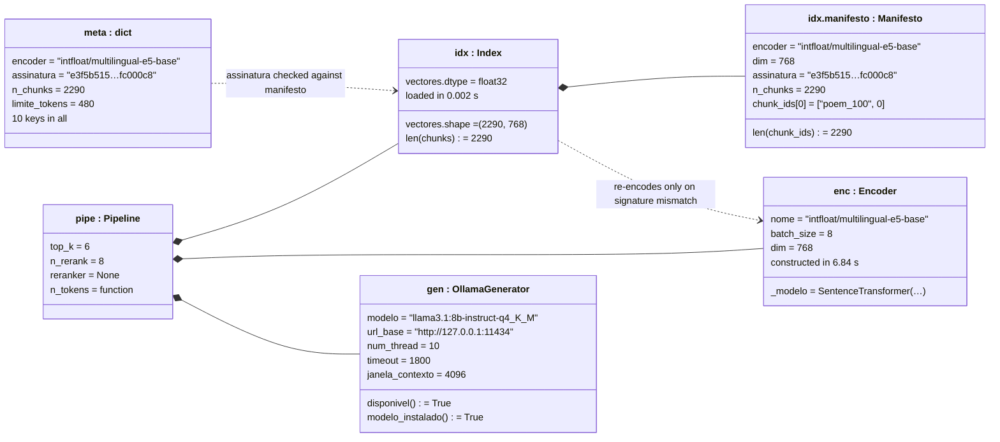
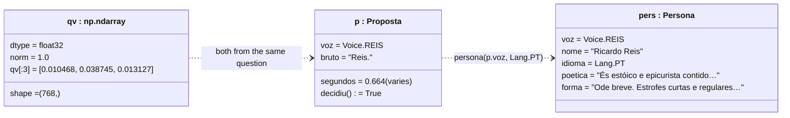
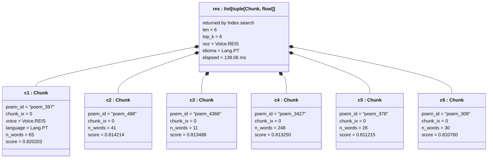
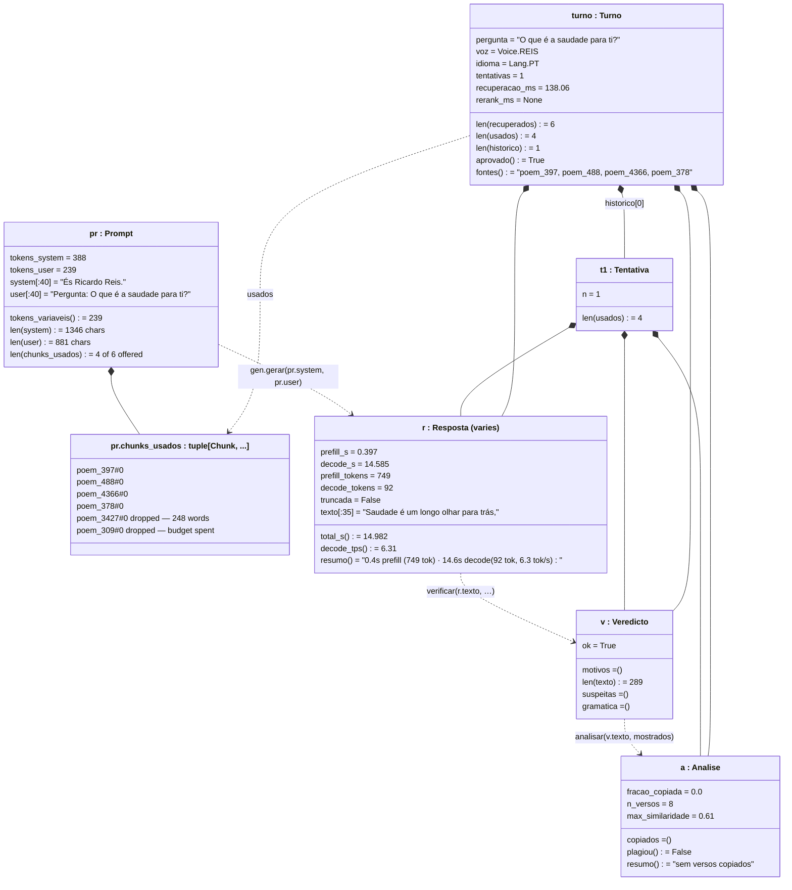
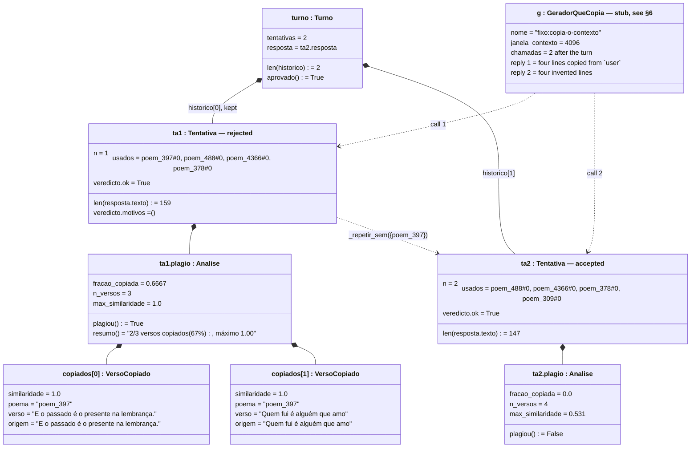
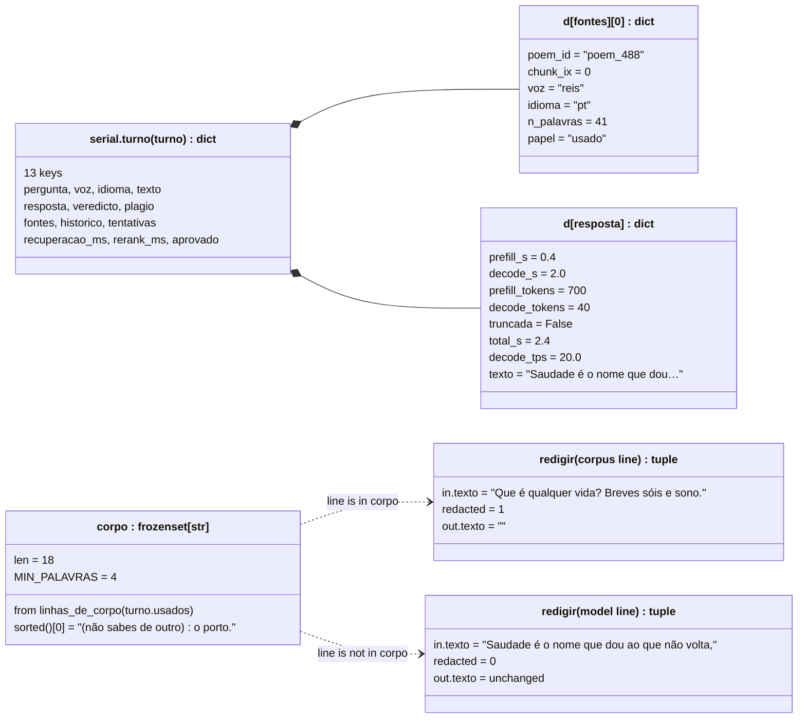

# One question, as the objects that answer it

```
┌─────────────────────────────────────────────────────────────────────────────────────────────┐
│ Name        uml-object-diagram                                                              │
│ Type        UML object diagram — Mermaid `classDiagram` with instance-style labels          │
│ Project     conversando_com_pessoa                                                          │
│ Description Instance snapshots along one real question — «O que é a saudade para ti?» —     │
│             answered end to end on this machine against the 2290-chunk index and a local    │
│             Ollama. Every attribute value below was printed by running the code, not read   │
│             off the source: 0.820203 is a dot product the index computed, and the 749       │
│             prefill tokens are Ollama's own count. §6 names the single object that is       │
│             stubbed and why, and §7 gives the commands that regenerate each snapshot.       │
└─────────────────────────────────────────────────────────────────────────────────────────────┘
```

## 0. The run these objects come from

One question was asked of the real system on 2026-10-21, on the machine this repository
is checked out on, with `data/corpus.jsonl` and `data/index` as they stand and `ollama`
serving `llama3.1:8b-instruct-q4_K_M` on `127.0.0.1:11434`:

> **O que é a saudade para ti?**

No model, index or corpus is stubbed. The script that produced §1–§4 is in §7 and takes
about 22 seconds, most of it the encoder loading and the 92 tokens Ollama decoded.

Mermaid has no object-diagram type, so these are `classDiagram` blocks whose nodes carry
instance-style labels — `class obj["name : Type"]` — which is the usual workaround. A
node is one object that existed at that moment; the lines inside it are its attributes
with the values it actually held.

**One caveat on reproducibility, stated up front.** The retrieval half is deterministic:
re-running the script gives byte-identical chunk ids and scores, which is how the two
runs behind this document agreed to six decimal places. The generation half is not —
`OllamaGenerator` sets `temperature = 0.9`, so the poem, the token counts and the
timings differ on every run. Where a value is of the second kind it is marked **(varies)**.
§5 shows one such difference between two runs of the identical command.

## 1. What exists before the question is asked

Three objects are built once and reused for every question. The `Encoder` costs about
7 s to construct — it is the whole reason `src/web/estado.py` is forbidden to touch one.



The two `assinatura` values are the same string, and that is the point of the object:
`Index.load` compares the signature in `data/index/index.manifest.json` against the one
in `data/corpus.jsonl`'s metadata and refuses to use an index built from a different
corpus. The `0.002 s` load is what you get when they match; on a mismatch, the encoder
re-encodes all 2290 chunks.

`reranker = None` is the default `Pipeline`. The CLI and the web service both attach one
on request, and `rerank_ms` in §4 is `null` because this run had none.

## 2. Routing, and the query vector

`rotear` asks the same local model, with `temperature = 0.0` and `MAX_TOKENS = 8`, which
of the four routable voices should answer.



`bruto = "Reis."` is the model's literal reply, with the full stop; `interpretar` maps it
onto `Voice.REIS`. `segundos = 0.664` is marked as varying for a reason worth recording:
the first run of this same script measured **22.612 s** for exactly this call, because the
model was cold. The second, a few minutes later, got 0.664 s from a warm one. That 34×
gap is why `src/roteador.py` has an `aquecer` function at all, and why
`Servico.roteador_aquecido` exists.

The query vector is L2-normalised to 1.0, which is what makes `Index.search`'s plain dot
product `self.vectores @ q` a cosine similarity — and what makes the scores in §3
comparable to each other.

## 3. The six chunks that came back, with their real scores

`idx.search(qv, top_k=6, voz=Voice.REIS, idioma=Lang.PT)`. This is the deterministic
half: the ids and the scores below are reproducible exactly.



The `text` attribute is left out of the boxes above only to keep them legible; these are
its first words, as they came back:

| object | `poem_id` | score | `n_words` | `text` begins |
|---|---|---|---|---|
| `c1` | `poem_397` | 0.820203 | 65 | E o passado é o presente na lembrança. / Quem fui é alguém que amo |
| `c2` | `poem_488` | 0.814214 | 41 | Que é qualquer vida? Breves sóis e sono. / Quanto pensas emprega |
| `c3` | `poem_4366` | 0.813488 | 11 | A quem outra persegue / A imagem repetida / Do abismo onde perdê-la. |
| `c4` | `poem_3427` | 0.813250 | 248 | Sossegadamente fitemos o seu curso e aprendamos / Que a vida passa |
| `c5` | `poem_378` | 0.811215 | 26 | Saiba a lei o que vive. / De sua natureza murcham rosas |
| `c6` | `poem_309` | 0.810760 | 30 | Mais vale, se a memória é quanto temos, / Lembrar muito que pouco |

Every `chunk_ix` is `0`, and that is not a coincidence of this query: Ricardo Reis writes
short odes, and `chunk_poem` splits only above `LIMITE_TOKENS = 480`, so almost every Reis
poem is one chunk. `poem_3427` at 248 words is the one long piece in the set and it still
fits in a single chunk.

The scores are packed into a 0.0095 band between first and sixth. Six near-ties is what
a dense-only retrieval over 2290 short lyric poems looks like, and it is the measurable
argument for the reranker that this run did not use.

## 4. The prompt, the response, the verdicts, the turn

`montar` is given all six chunks and fits **four** of them: `ORCAMENTO_USER = 300` tokens
with a `RESERVA = 24`, and the four it kept cost 239.



Three values here are each worth one sentence.

`prefill_tokens = 749` is Ollama's count of what it was actually sent, against
`tokens_system + tokens_user = 627` counted by this project's own tokeniser before
sending. The 122-token gap is the chat template and the tokeniser difference — the budget
in `montar` is an estimate made with the *encoder's* tokeniser, not the generator's, and
this is the size of that approximation.

`max_similaridade = 0.61` with `plagiou() = False`: the closest any of the eight generated
lines came to a line it was shown was 0.61, under the `LIMIAR_VERSO = 0.72` threshold. The
guard did fire and did not trip.

`len(historico) = 1` means the first attempt was accepted. §5 is the other case.

## 5. The same call, a second time: the retry, and what it changes

The run above took one attempt. An **earlier run of the identical command**, with a cold
model, took two — `tentativas = 2`, `len(historico) = 2`, `prefill_tokens = 835`,
`decode_tokens = 47`, `decode_tps = 5.74`, `recuperacao_ms = 134.07`, with the same six
chunk ids and the same six scores. That is temperature 0.9 doing what it does.

Because that is a coin toss, the retry is shown below from a **deterministic** run instead:
the real `Pipeline`, the real `montar`, the real `guard.verificar` and the real
`plagio.analisar`, with one stubbed object — a generator whose first reply is four lines
lifted straight out of its own context. That is the one fabricated value in this document,
it is marked as such in §6, and everything it produces downstream is real.



The `usados` lines of the two attempts are the finding. Attempt 1 used
`poem_397, poem_488, poem_4366, poem_378`; attempt 2 used
`poem_488, poem_4366, poem_378, poem_309`. `_repetir_sem` dropped `poem_397` — the poem
that was copied — and `poem_309`, the seventh-ranked chunk that had not fitted the budget
the first time, took its place. The retry is not the same prompt asked again; it is a
prompt with the copied source removed.

Note also that `veredicto.ok` is `True` on the **rejected** attempt. The persona guard and
the plagiarism analysis are separate judgements, and it was `plagiou()` alone that forced
the retry.

## 6. What is stubbed, and what is not

| object | real or stubbed |
|---|---|
| `meta`, `enc`, `idx`, `man`, `gen`, `pipe` (§1) | real; built from `data/` and a running Ollama |
| `p : Proposta`, `qv`, `pers` (§2) | real; `p.bruto` is the model's own reply |
| `c1…c6`, `res` (§3) | real; the scores are `Index.search`'s dot products |
| `pr : Prompt`, `r`, `v`, `a`, `t1`, `turno` (§4) | real; `r` is one Ollama generation |
| `ta1`, `ta2`, `aa1`, `aa2`, `vc1`, `vc2`, `turno2` (§5) | real objects, produced by the real `Pipeline` and the real guards |
| **`g : GeradorQueCopia` (§5)** | **stubbed.** The only invented object in this document |

`GeradorQueCopia` is a four-line class written for §5 and defined in full in §7. It exists
because the retry path is reached only when a 0.9-temperature model happens to copy, which
is not something a document can rely on. It implements the `Generator` protocol
structurally — `nome`, `janela_contexto`, `gerar`, `gerar_em_fluxo` — which is exactly the
substitution `tests/` make, and the `VersoCopiado` values it causes were computed by the
real `plagio.analisar` against the real retrieved chunks.

Nothing else in this document is unexecuted. There are no values here that were read off
the source and written down as if they had been measured.

## 7. Reproducing these values

All three snippets run from the repository root with the project's own `.venv`. §1–§5
additionally need `data/corpus.jsonl` and `data/index` present; §1–§4 need `ollama serve`
with `llama3.1:8b-instruct-q4_K_M` pulled. §5's snippet does **not** need Ollama.

### §1–§4 — the live turn

```bash
PYTHONPATH=. .venv/bin/python - <<'EOF'
from src.corpus.build import load
from src.corpus.models import Lang, Voice
from src.retrieval.encoder import Encoder
from src.retrieval.index import Index
from src.generation.ollama import OllamaGenerator
from src.generation.prompt import montar
from src.tokens import contador
from src.pipeline import Pipeline
from src.voices import persona
from src.roteador import rotear

PERGUNTA = "O que é a saudade para ti?"
meta, chunks = load()
enc = Encoder()
idx = Index.load(chunks, enc, meta["assinatura"])
gen = OllamaGenerator()
pipe = Pipeline(idx, enc, gen, contador(meta["encoder"]))

print("§1", idx.vectores.shape, idx.manifesto.assinatura[:8],
      idx.manifesto.n_chunks, enc.dim, gen.janela_contexto)

p = rotear(PERGUNTA, gen)
print("§2", p.voz, repr(p.bruto), round(p.segundos, 3), p.decidiu)

qv = enc.encode_queries([PERGUNTA])[0]
print("§2", qv.shape, round(float((qv @ qv) ** 0.5), 6), qv[:3])

for c, s in idx.search(qv, top_k=6, voz=p.voz, idioma=Lang.PT):
    print("§3", c.poem_id, c.chunk_ix, c.n_words, round(s, 6))

pr = montar(PERGUNTA, [c for c, _ in idx.search(qv, top_k=6, voz=p.voz,
                                                idioma=Lang.PT)],
            persona(p.voz, Lang.PT), contador(meta["encoder"]))
print("§4", pr.tokens_system, pr.tokens_user, len(pr.chunks_usados),
      [f"{c.poem_id}#{c.chunk_ix}" for c in pr.chunks_usados])

t = pipe.responder(PERGUNTA, p.voz, Lang.PT)
print("§4", t.resposta.resumo(), t.tentativas, round(t.recuperacao_ms, 2),
      t.rerank_ms, t.aprovado, t.fontes())
print("§4", t.veredicto.ok, t.veredicto.motivos,
      t.plagio.resumo(), round(t.plagio.max_similaridade, 4))
EOF
```

### §5 — the retry, deterministically

```bash
PYTHONPATH=. .venv/bin/python - <<'EOF'
from src.corpus.build import load
from src.corpus.models import Lang, Voice
from src.retrieval.encoder import Encoder
from src.retrieval.index import Index
from src.generation.base import Resposta
from src.tokens import contador
from src.pipeline import Pipeline

class GeradorQueCopia:
    """Devolve, à primeira, versos tirados do próprio contexto."""
    nome = "fixo:copia-o-contexto"
    janela_contexto = 4096

    def __init__(self):
        self.chamadas = 0

    def gerar(self, system, user):
        self.chamadas += 1
        if self.chamadas == 1:
            texto = "\n".join([l for l in user.split("\n")
                               if len(l.split()) >= 4][:4])
        else:
            texto = ("Saudade é o nome que dou ao que não volta,\n"
                     "e o tempo é a mão que o não deixa voltar.\n"
                     "Nada me resta senão olhar sereno\n"
                     "o rio que não torna a passar.")
        return Resposta(texto, 0.4, 2.0, 700, 40, False)

    def gerar_em_fluxo(self, system, user):
        yield self.gerar(system, user).texto

meta, chunks = load()
enc = Encoder()
idx = Index.load(chunks, enc, meta["assinatura"])
g = GeradorQueCopia()
turno = Pipeline(idx, enc, g, contador(meta["encoder"])).responder(
    "O que é a saudade para ti?", Voice.REIS, Lang.PT)

print("chamadas", g.chamadas, "tentativas", turno.tentativas)
for t in turno.historico:
    print(t.n, [f"{c.poem_id}#{c.chunk_ix}" for c in t.usados],
          t.veredicto.ok, t.plagio.plagiou, t.plagio.resumo())
    for x in t.plagio.copiados:
        print("   ", round(x.similaridade, 4), x.poema, repr(x.verso))
EOF
```

### §8 — the wire shapes and the retention

Self-contained; it rebuilds the §5 `turno` by importing that snippet's class from a file.
Save the §5 snippet's body as `/tmp/retry.py` first, or paste `GeradorQueCopia` in again.

```bash
PYTHONPATH=.:/tmp .venv/bin/python - <<'EOF'
from retry import turno          # the §5 snippet, saved as /tmp/retry.py
from src.web import serial
from src.web.retencao import linhas_de_corpo, redigir
print(sorted(serial.turno(turno).keys()))
print(serial.chunk(turno.usados[0]))
print(serial.resposta(turno.resposta))
corpo = linhas_de_corpo(turno.usados)
print(len(corpo), "linhas de corpo")
print(redigir({"tipo": "fragmento",
               "texto": turno.usados[0].text.split("\n")[0]}, corpo))
print(redigir({"tipo": "fragmento",
               "texto": "Saudade é o nome que dou ao que não volta,"}, corpo))
print(serial.turno(turno)["fontes"][0])
EOF
```

## 8. One more snapshot: the objects on the wire

The same `turno` from §5, put through `src/web/serial.py` and `src/web/retencao.py` —
the two modules that stand between an object and a browser.



`serial.chunk` emits five keys — `poem_id`, `chunk_ix`, `voz`, `idioma`, `n_palavras` —
and **no `text`**. The poem body does not cross into a source citation at all; `fontes`
adds only a `papel` field on top of those five. That is the egress property the
[`NOTACAO.md`](NOTACAO.md) assessment in this folder asks for a diagram of, visible here as
the absence of a field.

`corpo` holds 18 lines, drawn from the four chunks that were actually shown, filtered to
those of at least `MIN_PALAVRAS = 4` words. The two `redigir` calls are the retention gate
I7′ deciding in both directions: a line that is in the corpus comes back emptied with a
count of 1, and a line the model made up passes through untouched with a count of 0.

## What this document is not

It is one question, on one machine, on one afternoon. The deterministic values will
reproduce; the generation values will not, and are marked. Nothing keeps any of it in sync
with `src/` — the same caveat as the rest of this folder. The static counterpart is
[`uml-class-diagram.md`](uml-class-diagram.md), and §7 here is the recipe for taking this
snapshot again.
